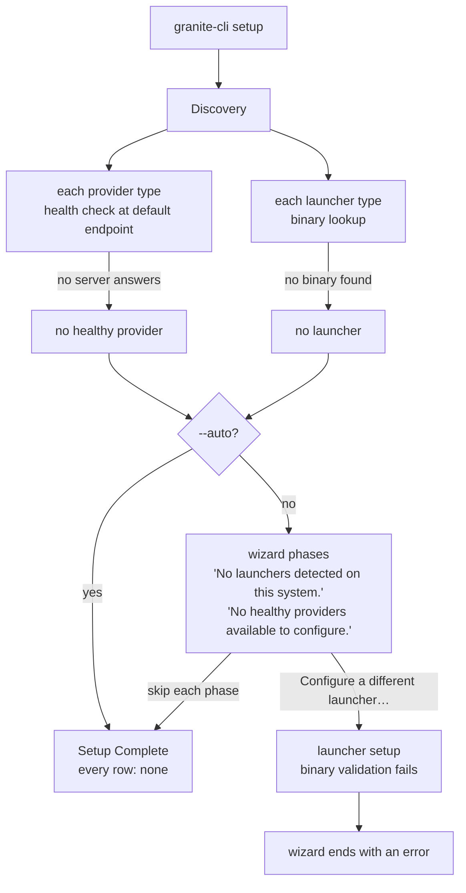
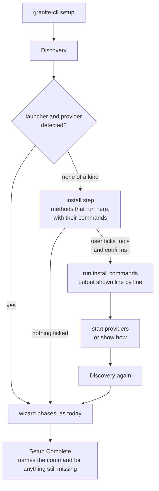
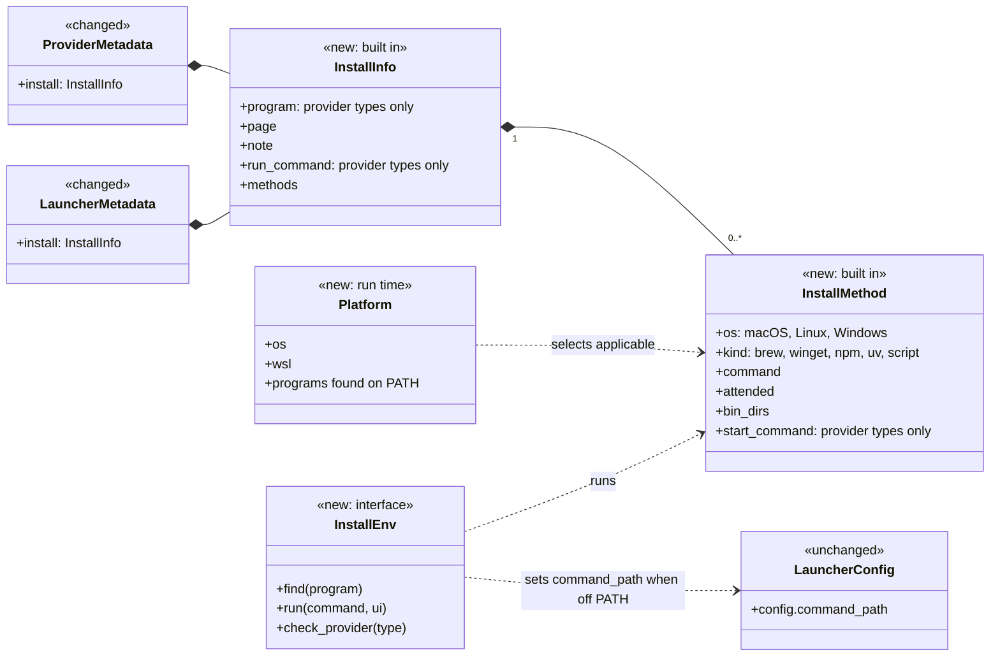
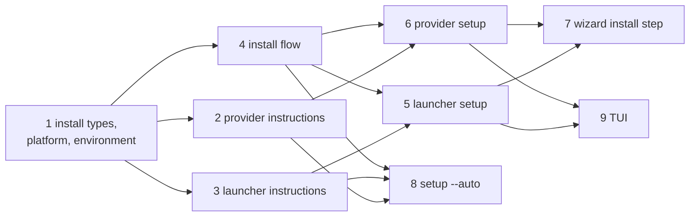

# Plan: From-Scratch Setup

Issues #188 and #189.

## Overview

`granite-cli setup` configures providers, models, launchers and capabilities
in one run (spec 0023). It begins with discovery. Discovery goes through every
provider type and launcher type in the registries and records which ones are
available on this machine. Everything the wizard offers later, and everything
`setup --auto` configures, comes from that record.

Discovery checks a provider type by building it with the registry's default
configuration and running its health check, an HTTP request to its default
endpoint. It checks a launcher type by resolving its binary: the
`command_path` from its configuration when one is set, otherwise a PATH lookup
of its default command.

```
  provider type       kind     default endpoint            what the user runs
  ─────────────       ────     ────────────────            ──────────────────
  ollama              local    http://localhost:11434      the Ollama server
  llama-cpp           local    http://localhost:8080       llama.cpp's llama-server
  lm-studio           local    http://localhost:1234       the LM Studio desktop app
  openai-compatible   hosted   http://localhost:8080       any server with an OpenAI API
  openrouter          hosted   https://openrouter.ai/api   a hosted service

  launcher type       binary     name
  ─────────────       ──────     ────
  claude              claude     Claude CLI
  bob                 bob        Bob CLI (also runs pi)
  goose               goose      Goose CLI
  hermes              hermes     Hermes CLI
  openclaw            openclaw   OpenClaw CLI
  opencode            opencode   OpenCode CLI
  pi                  pi         Pi CLI
```

On a machine where none of these are installed, discovery finds nothing, and
both modes of setup end with nothing configured:



```
$ granite-cli setup --auto
=== granite-cli Auto Setup ===

Auto-detecting and configuring all available components...


=== Setup Complete ===
Providers: none
Models: none
Launchers: none
Capabilities: none

Run `granite-cli launcher list` to see configured launchers.
```

This causes five problems.

- **Setup on a new machine configures nothing and does not say why.**
  `setup --auto`, which `install.sh` runs in CI mode, prints "none" on every
  row with no hint of what to install. The wizard says that no launcher and
  no healthy provider were found, and offers only to configure one by hand.
- **Configuring a missing launcher by hand ends the wizard.** The wizard's
  "Configure a different launcher…" entry runs `launcher setup`. That command
  fails when the binary is not found, and the failure ends the whole wizard
  with an error, so the choices made earlier in the run are not saved.
- **`launcher setup` stops at a missing binary with no way forward.** It asks
  for every setting first, then fails with "Binary validation failed … Set
  command_path to the full path of the binary and re-run setup". A user who
  has not installed the tool learns nothing from this.
- **`provider setup` cannot tell "not installed" from "not running".** It
  saves the provider, runs the health check, and on failure prints "It may
  need to be started or configured differently." The user has to work out
  whether to install the server, start it, or correct the endpoint.
- **granite-cli holds no install knowledge.** The metadata of provider and
  launcher types has no install information, and spec 0023 lists provider
  installation as a non-goal. Each user looks up the install page of every
  tool on their own.

These terms are used throughout:

- **Provider type** and **launcher type**: a key in the provider or launcher
  registry, such as `ollama` or `opencode`. The registry also holds each
  type's metadata: its name, description and defaults.
- **Detected**: a provider type is detected when its health check succeeds at
  its default endpoint. A launcher type is detected when its binary resolves.
- **Local provider** and **hosted provider**: the kind each provider type
  declares in its metadata. A local provider is a server the user runs; a
  hosted provider is a service on the internet. `openai-compatible` is
  declared hosted although its default endpoint is on localhost.

## Use Cases

Each use case is runnable once the sub-tasks below are complete.

Starting from nothing:

1. **Install during the wizard.** On a machine with no agent tool and no
   model server, `granite-cli setup` lists the tools it can install here,
   with the command for each, and installs the ones the user ticks. The
   wizard then continues with them as if they had been found.
2. **Learn what is missing in auto mode.** `granite-cli setup --auto` on the
   same machine installs nothing, and says that no launcher and no provider
   were found, with the commands that would fix it.
3. **Install in auto mode, by name.** `granite-cli setup --auto --install
   ollama --install opencode` installs those two tools, starts Ollama, and
   configures both without asking.

One tool at a time:

4. **Set up a launcher that is not installed.** `granite-cli launcher setup
   opencode` offers to install OpenCode when its binary is missing, and
   continues with the binary it installed.
5. **Set up a provider that is not installed.** `granite-cli provider setup
   ollama` offers to install Ollama when nothing answers at its endpoint and
   the program is missing, then offers to start it.
6. **Start a provider that is installed but not running.** `provider setup`
   offers to start the server, or shows the command to start it and checks
   again when the user is ready.
7. **Read the instructions without running anything.** `granite-cli launcher
   info goose` and `granite-cli provider info lm-studio` show how to install
   the type on this machine.

When granite-cli cannot install a tool:

8. **A GUI or administrator install.** For LM Studio, and for any method
   that needs a password, granite-cli shows the instructions and the page to
   download from, and runs nothing.
9. **No suitable package manager.** When no method can run here, for example
   on a Mac without Homebrew, granite-cli says which program each method needs
   and shows the manual instructions.

In the TUI:

10. **Install from the setup pane.** Setting up a provider or launcher from
    the TUI makes the same offer, shows the installer's output in the pane,
    and stops the installer on `Esc`.

## Proposal

Each provider type and launcher type carries **install instructions** in its
registry metadata: a list of **install methods**, each one a command for one
operating system and one package manager, and a page to read when no method
applies. When setup, `provider setup` or `launcher setup` finds a type
missing, granite-cli picks the methods that can run on this machine, shows the
exact command, and runs it only after the user chooses it. Once the command
finishes, granite-cli detects the type again and, for a provider, starts it or
says how to. Setup then continues as if the type had been there from the
start.



### Design decisions

In order of how much of the design depends on them.

1. **granite-cli runs an install command only when the user has chosen that
   command.** An interactive run lists each command in full, and runs the ones
   the user picks. `setup --auto` installs only the types named with
   `--install`, and with no `--install` it installs nothing. Installing
   software changes the machine outside granite-cli's own configuration, and
   a user may have reasons to install a tool another way.

2. **Install instructions are part of each type's registry metadata, compiled
   into the binary.** No configuration file can add a method or change a
   command. Install instructions are needed before any instance of the type
   exists and are the same for every instance, and the metadata already
   serves that purpose. Recommended configurations (spec 0025) are files
   users share, so a command read from user files could be a command someone
   else wrote.

3. **A method runs only when it can finish without input.** A method that
   needs administrator rights, a password, a GUI installer, or an answer to a
   question is marked attended and is shown as instructions. The installer
   runs with no terminal input, so it cannot ask anything; the TUI owns the
   terminal, and a password prompt during an install is a privilege decision
   the user should make in their own shell.

4. **For a provider, the health check decides whether it is available, and
   the program decides what to offer.** Each local provider type names the
   program its install puts on PATH. When the health check fails at a
   localhost endpoint, a missing program leads to the install offer, and a
   present program leads to the start offer. A failure at any other endpoint
   leads to neither, because the server is on another machine.

5. **The wizard offers installs once, right after discovery, and then runs
   discovery again.** The wizard picks capabilities and models using the
   healthy providers that discovery found. A provider installed during the
   Providers phase would arrive after those choices were made.

6. **A method applies when its operating system matches and the program it
   uses is on PATH.** The program is the package manager or downloader:
   `brew`, `winget`, `npm`, `uv`, `curl`. Methods are listed in the order the
   type declares, and the first one that applies is the default.

7. **granite-cli starts a provider only with a command that returns.** A
   method may name a start command that hands the server to the operating
   system's service manager, such as `brew services start ollama`. Without
   one, granite-cli shows the command that runs the server and waits for the
   user to start it. A server started as a child of granite-cli would stop,
   or lose its output, when granite-cli exits.

8. **Installer output is captured and passed to the UI one line at a time.**
   The same code then serves the terminal and the TUI setup pane, where a
   subprocess writing to the terminal would corrupt the screen.

9. **Under WSL, granite-cli shows instructions only.** `install.sh` installs
   the Windows build of granite-cli under WSL. A tool installed on the Linux
   side may not be found by that build, and one installed on the Windows side
   may not be what the user wants. Open Question 2 covers lifting this.

### What install instructions contain

Every provider type and launcher type declares install instructions, even when
there is nothing granite-cli can run. They hold:

- **Program**: the binary that shows the type is installed. For a launcher it
  is the default command. For a local provider it is declared, since the
  server's binary is not named anywhere today: `ollama`, `llama-server`,
  `lms`.
- **Page**: the vendor's install page, shown with manual instructions.
- **Note**: a sentence shown with the manual instructions, for steps that are
  not a command, such as "start the server from the Developer tab".
- **Run command**: for a local provider, the command that runs the server in
  the foreground, such as `ollama serve`, shown when granite-cli does not
  start it.
- **Methods**: zero or more install methods.

An install method holds:

- the operating systems it is for: macOS, Linux, Windows;
- its kind and the program it needs: Homebrew (`brew`), winget, npm, uv, or a
  vendor script (`curl` and `sh`, or PowerShell on Windows);
- the command line, run through the shell, so what is shown is what runs;
- whether it is attended (decision 3);
- directories the method installs into that may not be on PATH yet, such as
  a vendor script's `~/.local/bin`;
- for a provider, an optional start command (decision 7).

The methods below show the shape. They are illustrative: each command must be
checked against the vendor's current instructions when the sub-task that adds
it is written.

```
  type        os       kind     command                                              notes
  ────        ──       ────     ───────                                              ─────
  ollama      macOS    brew     brew install ollama                                  start: brew services start ollama
  ollama      Linux    script   curl -fsSL https://ollama.com/install.sh | sh        attended: asks for sudo
  ollama      Windows  winget   winget install --id Ollama.Ollama -e
  llama-cpp   macOS,   brew     brew install llama.cpp                               run: llama-server (router mode)
              Linux
  lm-studio   any      —        none: desktop app                                    page: https://lmstudio.ai
  openai-     any      —        none: point the provider at your server
  compatible
  openrouter  any      —        none: hosted                                         note: create an API key
  claude      macOS,   script   curl -fsSL https://claude.ai/install.sh | bash       dir: ~/.local/bin
              Linux
  claude      any      npm      npm install -g @anthropic-ai/claude-code
  opencode    macOS,   script   curl -fsSL https://opencode.ai/install | bash        dir: ~/.opencode/bin
              Linux
  opencode    any      npm      npm install -g opencode-ai
  goose       macOS    brew     brew install block-goose-cli
  pi          any      npm      npm install -g @mariozechner/pi-coding-agent
  openclaw    any      npm      npm install -g openclaw@latest
  hermes      macOS,   script   (vendor script)
              Linux
  bob         any      —        none: manual install                                 page: (vendor page)
```

A type with no methods still has a page or a note, so granite-cli always has
something to say about it. A test checks that every registered type declares
one or the other.

### Choosing a method on this machine

granite-cli builds a picture of the machine when it first needs to install
something: the operating system it was built for, whether it is running under
WSL, and which of the programs the methods need are on PATH. A method applies
when its operating system matches and its program is found. Each method that
does not apply is listed with the reason:

```
$ granite-cli launcher info goose
Launcher: goose
  Name         Goose CLI
  Command      goose (not found on PATH)
  Install      brew install block-goose-cli            Homebrew not found
               curl -fsSL …/download_cli.sh | bash     ✓ runs on this machine
  Page         https://block.github.io/goose/
```

`provider info` and `launcher info` show this for a catalog type, so the
instructions can be read without running anything.

When no method applies, or every method that applies is attended, granite-cli
shows the manual instructions: every method for this operating system, with
what each needs, then the page and the note.

```
LM Studio is a desktop app and cannot be installed from granite-cli.
  1. Download it from https://lmstudio.ai and open it.
  2. Start the server from the Developer tab.
Then run `granite-cli provider setup lm-studio` again.
```

### Asking and running

An offer lists the methods that apply, each as its full command, and a line
that installs nothing. Choosing a command is the consent to run it.

```
⚠ 'opencode' not found on PATH.
? Install OpenCode CLI now?
  › npm install -g opencode-ai
    curl -fsSL https://opencode.ai/install | bash
    Don't install (show manual instructions)
```

granite-cli runs the chosen command through the shell (`sh -c` on macOS and
Linux, PowerShell on Windows) with no input attached. It prints each line of
output as it arrives, indented under the command:

```
Running: npm install -g opencode-ai
  │ added 1 package in 4s
✓ Installed: /opt/homebrew/bin/opencode
```

There is no time limit; installs can take minutes.

**Failure.** A non-zero exit status is reported with the last 20 lines of
output, and followed by the manual instructions. Nothing is saved, and the
command that offered the install carries on as it does today when the type is
missing.

```
Running: npm install -g opencode-ai
  │ npm error code EACCES
  │ npm error syscall mkdir
  │ npm error path /usr/local/lib/node_modules/opencode-ai
✗ Install failed (exit status 243).
  To install OpenCode CLI yourself, see https://opencode.ai/docs/
```

**Cancellation.** `Ctrl-C` in a terminal stops the installer and granite-cli
together, as for any foreground process. In the TUI, `Esc` stops the
installer and closes the pane. In both cases granite-cli saves nothing; files
the installer had already written stay where they are.

**Non-interactive runs** never offer an install. A run is non-interactive
under `setup --auto` and with an output format that cannot prompt (`json`,
`markdown`). There, the message that a type is missing names the command to
install it, and only `setup --auto --install` runs one.

### After the install

granite-cli detects the type again, with the same check discovery uses.

**A launcher** is detected when its binary resolves. A vendor script often
installs into a directory that this shell's PATH does not include yet. When
the binary is not on PATH, granite-cli looks in the method's directories, and
when it finds it there it sets the launcher's `command_path` to it:

```
✓ Installed.
⚠ 'opencode' is not on PATH in this shell. Found /Users/me/.opencode/bin/opencode.
  command_path set to /Users/me/.opencode/bin/opencode.
  Add /Users/me/.opencode/bin to PATH to run opencode outside granite-cli.
```

When the binary is found nowhere, granite-cli reports the install as failed.

**A provider** is installed but usually not running. When the method has a
start command, granite-cli offers it:

```
✓ Installed: /opt/homebrew/bin/ollama
? Start Ollama now?
  › brew services start ollama
    I'll start it myself
Running: brew services start ollama
  │ ==> Successfully started `ollama` (label: homebrew.mxcl.ollama)
Waiting for http://localhost:11434 … healthy after 0.6s
```

granite-cli runs the health check every second for up to 10 seconds. When
there is no start command, or the user starts the server, granite-cli shows
the run command and waits for the user:

```
Start Ollama in another terminal:
    ollama serve
? Ollama is not answering at http://localhost:11434.
  › Check again
    Continue without it
```

"Continue without it" leaves the provider configured but not healthy, which
is what `provider setup` does today when the health check fails.

### In `launcher setup` and `provider setup`

**`launcher setup <type>`** offers the install where it fails today: after
the settings, when the binary does not resolve and `command_path` is empty or
a bare command name. An explicit path that does not exist is a typing
mistake, and is reported as it is today. When the install succeeds, setup
goes on to the capability choices. When the user declines or the install
fails, setup stops with the manual instructions.

```
$ granite-cli launcher setup opencode

Setting up launcher: opencode
OpenCode CLI launcher
Default command: opencode (leave command_path blank to use PATH lookup)
Instance name: opencode
command_path:
⚠ 'opencode' not found on PATH.
? Install OpenCode CLI now?
  › npm install -g opencode-ai
    curl -fsSL https://opencode.ai/install | bash
    Don't install (show manual instructions)
Running: npm install -g opencode-ai
  │ added 1 package in 4s
✓ Installed: /opt/homebrew/bin/opencode
? Select capabilities to enable [SPACE]
  ...
Launcher 'opencode' configured successfully!
```

**`provider setup <type>`** offers the install or the start after the health
check fails, following decision 4. A hosted type gets its note, with no
offer.

```
$ granite-cli provider setup ollama
...
Running health check...
⚠ Provider 'ollama' health check failed: Connection failed.
  'ollama' is not installed on this machine.
? Install Ollama now?
  › brew install ollama
    Don't install (show manual instructions)
Running: brew install ollama
  │ ==> Fetching ollama
  │ ==> Pouring ollama--…arm64_sequoia.bottle.tar.gz
✓ Installed: /opt/homebrew/bin/ollama
? Start Ollama now?
  › brew services start ollama
    I'll start it myself
Running: brew services start ollama
  │ ==> Successfully started `ollama` (label: homebrew.mxcl.ollama)
Waiting for http://localhost:11434 … healthy after 0.6s
Provider 'ollama' is healthy!
```

```
$ granite-cli provider setup ollama
...
Running health check...
⚠ Provider 'ollama' health check failed: Connection failed.
  'ollama' is installed (/usr/local/bin/ollama) but not answering at http://localhost:11434.
Start Ollama in another terminal:
    ollama serve
? Ollama is not answering at http://localhost:11434.
  › Check again
    Continue without it
```

The wizard's "Configure a different launcher…" and "Configure a different
provider…" entries call these two commands, so they gain the same offer. A
launcher setup that ends without a binary no longer ends the wizard: the
wizard reports it and shows the launcher list again.

### In the setup wizard

After discovery, the wizard checks two things: whether any launcher type was
detected or is configured, and whether any provider type is healthy or is
configured. For each kind with none, it shows an install step. Launchers come
first, the same order as the wizard's phases.

The step is a multi-select with nothing ticked, so pressing `Enter` installs
nothing. Types with no method that runs here are listed underneath, with
where to read more.

```
=== granite-cli Setup Wizard ===

Discovering available components...

No agent tools were found on this machine.
? Select agent tools to install [SPACE]
  [ ] claude    Claude CLI     curl -fsSL https://claude.ai/install.sh | bash
  [ ] opencode  OpenCode CLI   npm install -g opencode-ai
  [ ] openclaw  OpenClaw CLI   npm install -g openclaw@latest
  [ ] pi        Pi CLI         npm install -g @mariozechner/pi-coding-agent
  Not installable here: bob, goose (needs Homebrew), hermes.
  Run `granite-cli launcher info <type>` for instructions.

No model server is running on this machine.
? Select model servers to install [SPACE]
  [ ] ollama     Ollama      brew install ollama
  [ ] llama-cpp  llama.cpp   brew install llama.cpp
  Not installable here: lm-studio (desktop app).
  Hosted providers can be added in the Providers step.
```

Each multi-select lists the first method that applies for each type. Before
running anything, the wizard repeats the commands and asks once:

```
These commands will run:
  npm install -g opencode-ai
  brew install ollama
? Run them now? (Y/n)
```

The installs run one after the other, as described above, and each provider
gets its start offer. A failure is reported and the rest go on. The wizard
then runs discovery again and continues with its phases. Types installed in
this run are ticked in the Launchers and Providers lists, as types configured
through "Configure a different …" are today.

The summary names a command for each kind that is still empty:

```
=== Setup Complete ===
Providers: none
  Install one with `granite-cli provider setup ollama`.
Models: none
Launchers: opencode
Capabilities: agent-model
```

### In `setup --auto`

`setup --auto` installs nothing by default. When a kind has nothing detected
and nothing configured, it prints a warning naming, for each type with a
method that runs here, the command it would run:

```
$ granite-cli setup --auto
=== granite-cli Auto Setup ===

Auto-detecting and configuring all available components...

⚠ No launcher found. To install one:
    claude     curl -fsSL https://claude.ai/install.sh | bash
    opencode   npm install -g opencode-ai
  or let setup install it: granite-cli setup --auto --install opencode
⚠ No model server running. To install one:
    ollama     brew install ollama
  or let setup install it: granite-cli setup --auto --install ollama
...
```

`--install <type>` may be repeated, and requires `--auto`. For each named
type, setup runs the first method that applies, then that method's start
command when it has one, before discovery. A provider with no start command is
reported as installed but not running. A named type with no method that runs
here is reported with its manual instructions. Setup continues after any of
these, and exits with a non-zero status at the end if a named install failed,
since a script that names a tool expects it to be there.

```
$ granite-cli setup --auto --install ollama --install opencode
=== granite-cli Auto Setup ===

Installing ollama: brew install ollama
  │ ...
✓ ollama installed; started with `brew services start ollama`; healthy
Installing opencode: npm install -g opencode-ai
  │ added 1 package in 4s
✓ opencode installed: /opt/homebrew/bin/opencode

Auto-detecting and configuring all available components...
...
```

### In the TUI

The TUI runs `provider setup` and `launcher setup` in its setup pane, so it
makes the same offers. The installer's output goes into the pane's output
log, and the footer shows that `Esc` stops it.

```
┌ providers — ollama ──────────────────────────────────────────────┐
│ Running health check...                                          │
│ ⚠ Provider 'ollama' health check failed: Connection failed.      │
│   'ollama' is not installed on this machine.                     │
│ Running: brew install ollama                                     │
│   │ ==> Fetching ollama                                          │
│   │ ==> Pouring ollama--…arm64_sequoia.bottle.tar.gz             │
│                                                                  │
└ [↑↓/jk] Scroll output  [Esc] Stop install ───────────────────────┘
```

Today `Esc` in the pane takes effect at the next prompt. During an install
there is no prompt, so the pane stops the installer directly.

### Data model



Install instructions are plain data returned by each type's metadata function,
next to the name and description it returns today. They are read from the
registry without building an instance.

Everything that touches the machine goes through one interface, the install
environment: looking a program up on PATH, running a command and passing its
output to the UI, and running a provider's health check after an install. The
real environment does these things. Tests use a fake one that answers from a
table and records the commands it was asked to run, so no test looks at PATH,
runs a command or opens a connection. The platform picture is built from the
environment, so a test can describe a Mac without Homebrew or a Linux machine
with npm.

## Open Questions

1. **Installers that ask for a password.** Ollama's Linux script calls `sudo`,
   so decision 3 makes Ollama instructions-only on Linux. Should granite-cli
   run such an installer when it is attached to a terminal and not in the
   TUI, and let the installer ask for the password itself?
2. **WSL.** Which side should a tool be installed on when granite-cli is the
   Windows build running under WSL, and how should the tool be found
   afterwards?
3. **`install.sh`.** Should it gain an environment variable, such as
   `INSTALL=ollama,opencode`, that it passes to `setup --auto --install`?
4. **How long to wait for a provider after starting it.** This spec uses 10
   seconds. A first start of Ollama after install may take longer.
5. **npm global installs that need root.** On Linux, `npm install -g` fails
   with EACCES when npm's global prefix is a system directory. Should
   granite-cli check the prefix first and treat the method as attended?
6. **Method order per type.** Some vendors recommend their script over a
   package manager (the Claude native installer over npm). The order of each
   type's methods needs a maintainer decision per type.
7. **Marking missing tools in the TUI.** Should the Providers and Launchers
   catalog rows show "not installed" or "not running"? This needs a detection
   pass when the TUI opens, which it does not do today.

## Out of Scope

- Installing a method's prerequisites: Homebrew, Node.js and npm, uv.
- Installing a tool's dependencies on other tools, such as Pi for Bob.
- Upgrading or uninstalling tools.
- Installing or starting providers on other machines.
- Signing up for hosted services, creating API keys, and logging in to agent
  tools. granite-cli shows the page and stops there.
- Checking checksums or signatures of vendor scripts. granite-cli runs the
  vendor's published command, as a user following the vendor's page would.
- Running an attended method (decided against, decision 3; see Open Question
  1).
- Pulling model weights. This stays as spec 0023 describes.

## Considered Alternatives

**A YAML file of install instructions.** `resources/installers.yaml` would
list the methods for every type, embedded by `build.rs` as the recommended
configurations are. All commands would sit in one reviewable file, and
updating a command would be a data change. The file would name types by
string, so an entry could name a type the registry does not have, or a type
could be missing an entry, and only a test would notice. Keeping the
instructions in each type's metadata puts them next to the code that runs the
tool, and a type cannot be registered without them.

**A method on the Provider and Launcher traits.** The issues suggest extending
the traits. A trait method belongs to an instance, so granite-cli would build
a throwaway instance with default settings to ask how to install the type, as
discovery does for health checks. Install instructions do not depend on an
instance's settings, and the metadata function already answers type-level
questions without building one.

**Starting the server as a background child of granite-cli.** granite-cli
would run `ollama serve` detached and go on. The server would outlive the
command with no owner: its output would go nowhere, nothing would restart it
after a reboot, and nothing would stop it. Service managers already do this
job, so granite-cli uses them where a method names one and otherwise leaves
starting to the user.

**Offering installs inside each wizard phase.** The Launchers phase would
offer launchers, and the Providers phase would offer providers. This keeps
each offer next to its list, but the Providers phase comes after capabilities
and models are chosen from the healthy providers, so a provider installed
there would not inform those choices (decision 5).

**`setup --auto --install-missing`.** One flag would install the first method
of the first type of each kind that is missing. It is shorter to type, but
granite-cli would choose which agent tool and which server to put on the
user's machine, and the choice would change when the registry order changes.

**Giving the installer the terminal.** Installers would show their own
progress bars and could ask questions. The TUI cannot hand over its terminal,
so it would need a second code path, and an installer could stop waiting for
input that `setup --auto` cannot give.

---

## Sub-Tasks

Each sub-task is one commit that leaves `main` working, with its tests and
documentation. Sub-tasks 1 to 3 add data and show it only in `info`.



Sub-tasks 1 to 3 make one pull request, 4 to 6 another, 7 and 8 a third, and
9 the last. Sub-tasks 2 and 3 can be written in parallel, as can 5 and 6.

---

### Sub-Task 1 — Install instructions, platform and install environment

**Intent**
Define install instructions and methods, describe the machine, and put
everything that touches it behind one interface.

**Expected Outcomes**

A new module defines install instructions and install methods as described
in "What install instructions contain". It builds a platform picture from an
install environment: the operating system, whether this is WSL, and which
programs the methods need are on PATH. Given install instructions and a
platform, it returns the methods that apply, in declared order, and for each
method that does not apply the reason: wrong operating system, program not
found, attended, or WSL.

The install environment is an interface with three operations: find a
program, run a command line through the shell passing each output line to
the UI, and check a provider type's health. The real environment spawns the
command with no input and its output captured, and keeps the last 20 lines
for a failure report. A fake environment answers from a table and records the
commands it was asked to run.

Nothing calls the module yet.

Tests cover: method selection on a Mac with and without Homebrew, on Linux
with npm only, and on Windows with winget; an attended method listed with its
reason and never selected; every method listed as not applying under WSL; the
fake environment recording commands and replaying scripted output; and the
real environment's output capture, using a command line built into the test
that prints three lines and exits non-zero, run only through the shell the
platform always has.

**Relevant Context**
- `src/utils/shell.rs` (`resolve_shell_command`, PATH lookup via `which`)
- `src/config/mod.rs:246` (`Config::is_wsl`)
- `src/launchers/base.rs:139` (`run_command`, spawn on a blocking thread,
  Windows handling)
- `src/utils/ui/base.rs:126` (`Ui`), `:284` (`CaptureUi`)
- AGENTS.md: no unit test may depend on installed binaries or the network

**Status** — `[ ]` not started

---

### Sub-Task 2 — Install instructions for every provider type

**Intent**
Give each provider type its install instructions and show them in `provider
info`.

**Expected Outcomes**

Provider metadata gains install instructions. Ollama, llama.cpp and LM Studio
declare their program, page, run command and methods; LM Studio has no
method that runs, since it is a desktop app. `openai-compatible` and
OpenRouter declare a note and no methods. Each command is checked against the
vendor's current instructions and the source is named in a comment.

`provider info <type>` for a catalog type shows the program and whether it was
found, each method with whether it runs here or why not, the page and the
note. `docs/data-model.md` lists the new metadata.

Tests cover: every registered provider type declaring a page or a note; local
types declaring a program; hosted types declaring no methods; and `provider
info` output through the test UI with a fake environment that has Homebrew and
one that does not.

**Relevant Context**
- `src/providers/base.rs:216` (`ProviderMetadata`, `ProviderType`)
- `src/providers/{ollama,llamacpp,lmstudio,openai,openrouter}.rs`
  (`metadata()`)
- `src/commands/provider.rs:116` (`info`)
- `docs/data-model.md`

**Status** — `[ ]` not started

---

### Sub-Task 3 — Install instructions for every launcher type

**Intent**
Give each launcher type its install instructions and show them in `launcher
info`.

**Expected Outcomes**

Launcher metadata gains install instructions. Each of the seven launcher
types declares a page and the methods its vendor publishes, with the
directories a vendor script installs into. A type whose install granite-cli
cannot run, such as Bob if its install needs a sign-in, declares a page and a
note only. The program is the type's default command.

`launcher info <type>` for a catalog type shows the same install detail as
`provider info`.

Tests cover: every registered launcher type declaring a page or a note; every
script method declaring at least one directory; and `launcher info` output
through the test UI with a fake environment that has npm and one that has
nothing.

**Relevant Context**
- `src/launchers/base.rs:397` (`LauncherMetadata`)
- `src/launchers/{claude,goose,hermes,openclaw,opencode,pi}.rs`,
  `src/launchers/bob/mod.rs:329` (`metadata()`; Bob also uses
  `pi_command_path`)
- `src/commands/launcher.rs:75` (`info`)
- `docs/data-model.md`

**Status** — `[ ]` not started

---

### Sub-Task 4 — The install flow

**Intent**
Offer, run and follow up an install in one place that the commands can call.

**Expected Outcomes**

One function offers the install of a type: it lists the methods that apply as
full commands with a line that installs nothing, runs the chosen one through
the install environment with its output shown line by line, and reports
failure with the last 20 lines and the manual instructions. It never prompts
when the UI is not interactive. A second entry point runs a given type's first
applicable method without asking, for `setup --auto --install`.

After a launcher install, the flow resolves the binary on PATH and then in the
method's directories, and returns the path found, so the caller can set
`command_path`. After a provider install, it offers the method's start
command, then checks health every second for up to 10 seconds; with no start
command it shows the run command and asks "Check again" or "Continue without
it". Manual instructions are printed in one format everywhere.

Tests cover, all with the fake environment and the test UI: declining runs
nothing; choosing a method runs exactly that command; a failure shows the last
lines and the manual instructions; a binary found only in a method directory
is returned with the PATH warning; a provider start command followed by a
healthy check; "Check again" until healthy; a non-interactive UI never
prompting; and a type with no applicable method going straight to manual
instructions.

**Relevant Context**
- the module from Sub-Task 1
- `src/utils/ui/base.rs` (`select`, `confirm`, `is_interactive`)
- `src/commands/shared/remediation.rs:123` (how a prompt is skipped when the
  UI is not interactive)

**Status** — `[ ]` not started

---

### Sub-Task 5 — `launcher setup` offers the install

**Intent**
Let `launcher setup` install a missing tool and carry on.

**Expected Outcomes**

When the binary does not resolve and `command_path` is empty or a bare name,
`launcher setup` calls the install flow. A successful install continues to
the capability choices, with `command_path` set when the binary was found off
PATH. A declined or failed install ends setup with the manual instructions
and saves nothing. An explicit path that does not exist fails as it does
today.

The wizard's "Configure a different launcher…" entry no longer ends the
wizard when launcher setup fails: it reports the failure and shows the
launcher list again.

Tests cover: an install that puts the binary on PATH, ending with the
launcher saved; one that puts it in a method directory, saving that path as
`command_path`; a declined install saving nothing; an explicit missing path
not offering an install; and the wizard's launcher list shown again after a
failed launcher setup.

**Relevant Context**
- `src/commands/launcher.rs:166` (`setup`), `:284` (the failure message)
- `src/commands/setup.rs:1671` (`select_launchers`), `:1756` (the call whose
  error ends the wizard)

**Status** — `[ ]` not started

---

### Sub-Task 6 — `provider setup` offers the install or the start

**Intent**
Let `provider setup` tell "not installed" from "not running", and act on it.

**Expected Outcomes**

When the health check fails and the endpoint's host is localhost or a
loopback address, `provider setup` looks for the type's program. Without it,
setup calls the install flow and then the start offer. With it, setup goes to
the start offer. A hosted type, or a provider on another host, gets its note
or today's warning. The provider is saved before the health check, as today,
so declining leaves it configured but not healthy.

The wizard's "Configure a different provider…" entry gains the same
behaviour through this command.

Tests cover: a missing program leading to the install offer and then the
start offer; a present program leading to the start offer only; a remote
endpoint leading to neither; a hosted type showing its note; and a declined
offer leaving the provider saved.

**Relevant Context**
- `src/commands/provider.rs:208` (`setup`), `:292` (health check after save),
  `:386` (`check_provider_health`)
- `src/commands/setup.rs:1767` (`select_providers`), `:1863`

**Status** — `[ ]` not started

---

### Sub-Task 7 — The wizard's install step

**Intent**
Offer installs right after discovery when a kind has nothing, and continue
with what was installed.

**Expected Outcomes**

After discovery, for launchers and then for providers, when nothing of that
kind is detected or configured, the wizard shows a multi-select of the types
with an applicable method and the command for each, with nothing ticked, and
lists the other types underneath. It repeats the chosen commands and asks
once before running them. Installs run in order, with the start offer for
each provider; a failure is reported and the rest go on. Discovery then runs
again, and installed types are ticked in the Launchers and Providers lists.
The summary names a command for each kind that is still empty.

Discovery today calls real health checks and PATH lookups, so the install
step takes the discovery result as an argument and runs discovery again
through a function the tests replace.

Tests cover: no step when a launcher and a provider are detected; the launcher
step alone when only providers are detected; pressing `Enter` running
nothing; two installs with one failing and the other ticked in the next
phase; and the summary hints for empty kinds.

**Relevant Context**
- `src/commands/setup.rs:82` (`run_with_hardware`), `:1186` (`run_wizard`),
  `:1671` and `:1767` (manual entries are ticked), `:2648` (`print_summary`)
- `src/commands/setup.rs` tests `run_wizard_with_empty_config_shows_info` and
  `run_auto_with_no_recommendations_shows_info`, which run real discovery

**Status** — `[ ]` not started

---

### Sub-Task 8 — `setup --auto` reports what is missing, and `--install`

**Intent**
Make `setup --auto` explain an empty result, and install named types when
asked.

**Expected Outcomes**

When a kind has nothing detected or configured, `setup --auto` prints a
warning with the command for each type that has an applicable method and the
`--install` form. `setup` gains `--install <type>`, repeatable and requiring
`--auto`. Each named type is installed with its first applicable method,
providers are started when the method has a start command, and discovery runs
afterwards. A named type that is unknown, has no applicable method, or fails
to install is reported, setup continues, and the exit status is non-zero at
the end. The README documents the flag next to the other setup flags.

Tests cover: the warnings on an empty run, with no command run; `--install`
running exactly the named types' commands; an unknown type and a type with no
applicable method reported with a non-zero exit; and `--install` without
`--auto` rejected by the argument parser.

**Relevant Context**
- `src/main.rs:160` (`Commands::Setup`), `:641` (routing)
- `src/commands/setup.rs:1304` (`run_auto_with_hardware`), `:1315` (the
  empty check that discovery never meets)
- `README.md` (setup flags), `install.sh:681` (`run_granite_setup`)

**Status** — `[ ]` not started

---

### Sub-Task 9 — Installs in the TUI setup pane

**Intent**
Show installer output in the setup pane, and let `Esc` stop the installer.

**Expected Outcomes**

Installer output lines appear in the pane's output log as they arrive. While
an installer runs, the footer reads "[Esc] Stop install", and `Esc` stops the
installer process and closes the pane, with nothing saved. The rest of the
offer uses the prompts the pane already supports.

Tests cover: output lines from a fake installer reaching the pane; the footer
hint while an installer runs; and `Esc` reaching the fake environment as a
stop request.

**Relevant Context**
- `src/utils/ui/app.rs:2441` (`spawn_setup`), `:2357` (logger silenced while
  the TUI owns the terminal)
- `src/utils/ui/setup_pane.rs:196` (`Esc` acts at the next prompt)
- `src/utils/ui/tui_ui.rs` (`OutputLine`)

**Status** — `[ ]` not started

