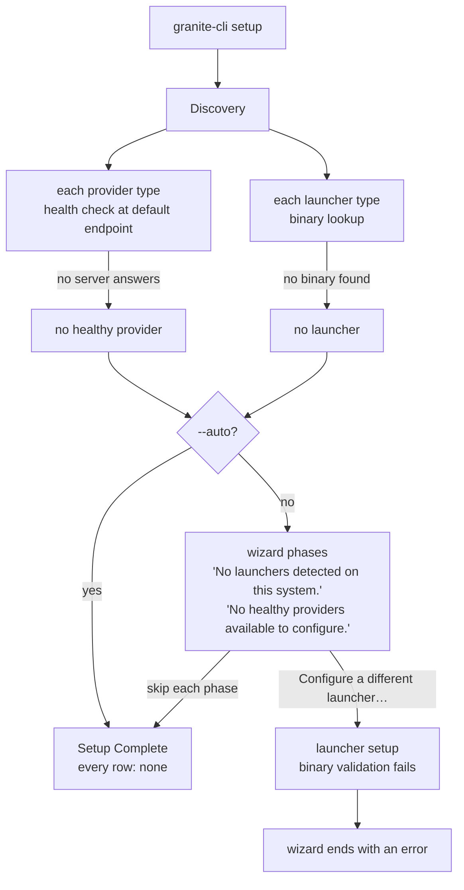
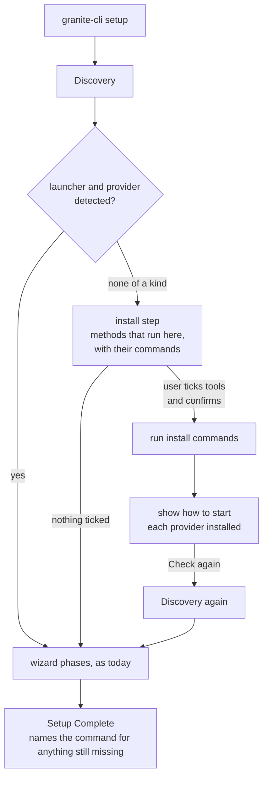
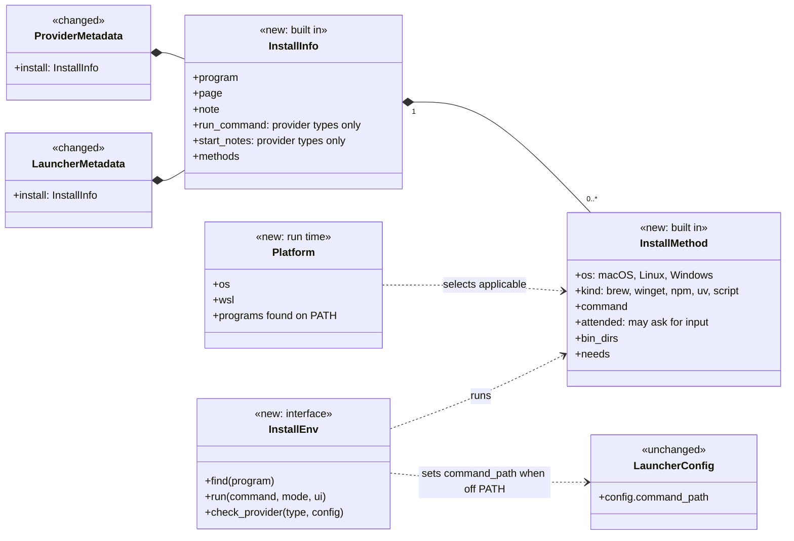
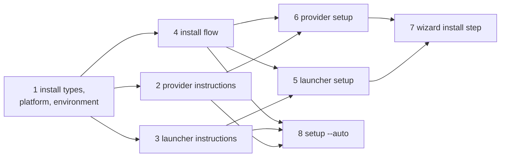

# Plan: From-Scratch Setup

Issues #188 and #189.

## Overview

`granite-cli setup` configures providers, models, launchers and capabilities
in one run (spec 0023). It begins with discovery. Discovery goes through every
provider type and launcher type in the registries and records which ones are
available on this machine. Everything the wizard offers later, and everything
`setup --auto` configures, comes from that record.

Discovery checks a provider type by building it with the registry's default
configuration and running its health check, an HTTP request to its default
endpoint. It checks a launcher type by resolving its binary: the
`command_path` from its configuration when one is set, otherwise a PATH lookup
of its default command.

```
  provider type       kind     default endpoint            what the user runs
  ─────────────       ────     ────────────────            ──────────────────
  ollama              local    http://localhost:11434      the Ollama server
  llama-cpp           local    http://localhost:8080       llama.cpp's llama-server
  lm-studio           local    http://localhost:1234       the LM Studio desktop app
  openai-compatible   hosted   http://localhost:8080       any server with an OpenAI API
  openrouter          hosted   https://openrouter.ai/api   a hosted service

  launcher type       binary     name
  ─────────────       ──────     ────
  claude              claude     Claude CLI
  bob                 bob        Bob CLI (also runs pi)
  goose               goose      Goose CLI
  hermes              hermes     Hermes CLI
  openclaw            openclaw   OpenClaw CLI
  opencode            opencode   OpenCode CLI
  pi                  pi         Pi CLI
```

On a machine where none of these are installed, discovery finds nothing, and
both modes of setup end with nothing configured:



```
$ granite-cli setup --auto
=== granite-cli Auto Setup ===

Auto-detecting and configuring all available components...


=== Setup Complete ===
Providers: none
Models: none
Launchers: none
Capabilities: none

Run `granite-cli launcher list` to see configured launchers.
```

This causes five problems.

- **Setup on a new machine configures nothing and does not say why.**
  `setup --auto`, which `install.sh` runs in CI mode, prints "none" on every
  row with no hint of what to install. The wizard says that no launcher and
  no healthy provider were found, and offers only to configure one by hand.
- **Configuring a missing launcher by hand ends the wizard.** The wizard's
  "Configure a different launcher…" entry runs `launcher setup`. That command
  fails when the binary is not found, and the failure ends the whole wizard
  with an error, so the choices made earlier in the run are not saved.
- **`launcher setup` stops at a missing binary with no way forward.** It asks
  for every setting first, then fails with "Binary validation failed … Set
  command_path to the full path of the binary and re-run setup". A user who
  has not installed the tool learns nothing from this.
- **`provider setup` cannot tell a missing server from a stopped one.** It
  saves the provider, runs the health check, and on failure prints "It may
  need to be started or configured differently." The user has to work out
  whether to install the server, start it, or correct the endpoint, and is
  not told how to do any of these.
- **granite-cli holds no install knowledge.** The metadata of provider and
  launcher types has no install information, and spec 0023 lists provider
  installation as a non-goal. Each user looks up the install page of every
  tool on their own.

These terms are used throughout:

- **Provider type** and **launcher type**: a key in the provider or launcher
  registry, such as `ollama` or `opencode`. The registry also holds each
  type's metadata: its name, description and defaults.
- **Detected**: a provider type is detected when its health check succeeds at
  its default endpoint. A launcher type is detected when its binary resolves.
- **Local provider** and **hosted provider**: the kind each provider type
  declares in its metadata. A local provider is a server the user runs; a
  hosted provider is a service on the internet. `openai-compatible` is
  declared hosted although its default endpoint is on localhost.
- **Terminal session**: a run of granite-cli with the terminal or plain
  output format, attached to a terminal, outside the TUI and outside
  `setup --auto`.

## Use Cases

Each use case is runnable once the sub-tasks below are complete.

Starting from nothing:

1. **Install during the wizard.** On a machine with no agent tool and no
   model server, `granite-cli setup` lists the tools it can install here,
   with the command for each, and installs the ones the user ticks. It shows
   how to start each model server it installed, and checks again when the
   user says the server is running. The wizard then continues with what it
   found.
2. **Learn what is missing in auto mode.** `granite-cli setup --auto` on the
   same machine installs nothing, and says that no launcher and no provider
   were found, with the commands that would fix it.
3. **Install in auto mode, by name.** `granite-cli setup --auto --install
   ollama --install opencode` installs those two tools without asking,
   configures OpenCode, and says how to start Ollama.

One tool at a time:

4. **Set up a launcher that is missing.** `granite-cli launcher setup
   opencode` offers to install OpenCode when its binary is missing, and
   continues with the binary it installed.
5. **Set up a provider that is missing.** `granite-cli provider setup
   ollama` offers to install Ollama when nothing answers at its endpoint and
   the program is missing. After the install it shows how to start the
   server and checks again when the user is ready.
6. **Learn how to start a provider whose program is on PATH but that does
   not answer.** `provider setup` says where it found the program, shows the
   command that
   runs the server, and checks again when the user is ready.
7. **Read the instructions without running anything.** `granite-cli launcher
   info goose` and `granite-cli provider info lm-studio` show how to install
   the type on this machine.

When granite-cli cannot run the install:

8. **A GUI install.** For LM Studio, granite-cli shows the page to download
   it from and how to start its server, and runs nothing.
9. **An installer that asks for a password.** In a terminal session the
   installer runs in the user's terminal and asks there. Without a terminal,
   for example `setup --auto --install` in CI, granite-cli still runs it:
   password-less sudo works, and a password question fails, which granite-cli
   reports with the command for the user to run.
10. **No suitable package manager.** When no method can run here, for example
    on a Mac without Homebrew, granite-cli says which program each method
    needs and shows the manual instructions.

Installing from the TUI is out of scope; spec 0029 covers it.

## Proposal

Each provider type and launcher type carries **install instructions** in its
registry metadata: a list of **install methods**, each one a command for one
operating system and one package manager, and a page to read when no method
applies. A local provider type also says how its server is started. When
setup, `provider setup` or `launcher setup` finds a type missing, granite-cli
picks the methods that can run on this machine, shows the exact command, and
runs it only after the user chooses it. Once the command finishes, granite-cli
detects the type again. A provider server is never started by granite-cli:
it shows how to start it and checks again when asked. Setup then continues as
if the type had been there from the start.



### Design decisions

In order of how much of the design depends on them.

1. **granite-cli runs an install command only when the user has chosen that
   command.** An interactive run lists each command in full, and runs the ones
   the user picks. `setup --auto` installs only the types named with
   `--install`, and with no `--install` it installs nothing. Installing
   software changes the machine outside granite-cli's own configuration, and
   a user may have reasons to install a tool another way.

2. **granite-cli never starts, stops or registers a provider server.** After
   an install, and whenever a local provider does not answer, it shows the
   command that runs the server and the platform's usual way to keep it
   running, such as `brew services start ollama`, as text. How a server
   should run differs by provider and by platform: a service under
   `brew services` or `systemd`, a foreground process, or a desktop app.
   Several providers, such as `llama-server` outside router mode, are not
   daemons at all.

3. **Install instructions are part of each type's registry metadata, compiled
   into the binary.** No configuration file can add a method or change a
   command. Install instructions are needed before any instance of the type
   exists and are the same for every instance, and the metadata already
   serves that purpose. Recommended configurations (spec 0025) are files
   users share, so a command read from user files could be a command someone
   else wrote.

4. **The installer runs in granite-cli's terminal, or with granite-cli's
   output when there is no terminal, and every method that applies is
   tried.** Vendor scripts run as `curl … | sh`, and `sudo`, read their
   answers from the terminal, so in a terminal session the user answers them.
   Without a terminal, such a question fails and the install is reported as
   failed, with the command to run by hand; password-less `sudo`, and root in
   a container, need no answer. A method that may ask for input is marked as
   such, so the user knows before choosing it, but it is not skipped: whether
   it can run is known only by trying. The TUI owns the terminal, so it does
   not install; it shows the manual instructions (spec 0029).

5. **For a local provider, a failed health check always says that the server
   is not answering, and the program on PATH decides whether to offer an
   install.** Each local provider type names the program its install puts on
   PATH. When the health check fails at a localhost endpoint and the program
   is missing, granite-cli offers the install, and says that the program may
   be installed elsewhere. When the program is present, it
   shows how to start the server. A failure at any other endpoint leads to
   neither, because the server is on another machine.

   PATH is not proof that a program is or is not installed, so the messages
   report only what was checked. A program missing from PATH is "not found
   on PATH", never "not installed", and the offer adds that it may be
   installed elsewhere. A program on PATH is "found at <path>". A failed
   health check is "not answering at <endpoint>", never "not running",
   since the server may run on another port or host (#218). After an install,
   "Installed" and "not answering" are reported as two separate facts.

6. **The wizard offers installs once, right after discovery, and then runs
   discovery again.** The wizard picks capabilities and models using the
   healthy providers that discovery found. A provider installed during the
   Providers phase would arrive after those choices were made.

7. **A method applies when its operating system matches and the program it
   uses is on PATH.** The program is the package manager or downloader:
   `brew`, `winget`, `npm`, `uv`, `curl`, plus `bash` for a command that
   pipes to it. Methods are listed in the order the type declares. An offer
   defaults to installing nothing, so pressing Enter never runs a command;
   `setup --auto --install` uses the first method that applies.

8. **Under WSL, granite-cli shows instructions only.** `install.sh` installs
   the Windows build of granite-cli under WSL. A tool installed on the Linux
   side may not be found by that build, and one installed on the Windows side
   may not be what the user wants. Open Question 1 covers lifting this.

### What install instructions contain

Every provider type and launcher type declares install instructions, even when
there is nothing granite-cli can run. They hold:

- **Program**: the binary that shows the type is installed. For a launcher it
  is the default command. For a local provider it is declared, since the
  server's binary is not named anywhere today: `ollama`, `llama-server`,
  `lms`.
- **Page**: the vendor's install page, shown with manual instructions.
- **Note**: a sentence shown with the manual instructions, for steps that are
  not a command, such as "Open LM Studio and start the server from the
  Developer tab".
- **Run command**: for a local provider, the command that starts the server,
  such as `ollama serve` or `lms server start`.
- **Start notes**: for a local provider, zero or more lines, each for one
  operating system, naming the usual way to keep the server running there,
  such as "Homebrew can run it as a service: `brew services start ollama`".
- **Methods**: zero or more install methods.

An install method holds:

- the operating systems it is for: macOS, Linux, Windows;
- its kind and the program it needs: Homebrew (`brew`), winget, npm, uv, or a
  vendor script (`curl` and `sh`, plus `bash` when the command pipes to it,
  or PowerShell on Windows);
- other programs the command needs on PATH, such as `npm` for a vendor script
  that installs through npm;
- the command line, run through the shell, so what is shown is what runs;
- whether it may ask for input, such as a `sudo` password (decision 4);
- directories the method installs into that may not be on PATH yet, such as
  a vendor script's `~/.local/bin`.

The methods below show the shape. Each command is checked against the
vendor's current instructions in the sub-task that adds it, and the source is
named next to it in the code.

```
  type        os       kind     command                                              notes
  ────        ──       ────     ───────                                              ─────
  ollama      macOS    brew     brew install ollama                                  start note: brew services start ollama
  ollama      Linux    script   curl -fsSL https://ollama.com/install.sh | sh        asks for input: sudo; dir: /usr/local/bin
  ollama      Windows  script   irm https://ollama.com/install.ps1 | iex
  llama-cpp   macOS,   brew     brew install llama.cpp                               run: llama-server
              Linux
  llama-cpp   Windows  winget   winget install llama.cpp
  lm-studio   any      —        none: desktop app                                    page: https://lmstudio.ai
  openai-     any      —        none: point the provider at your server
  compatible
  openrouter  any      —        none: hosted                                         note: create an API key
  claude      macOS,   script   curl -fsSL https://claude.ai/install.sh | bash       dir: ~/.local/bin
              Linux
  claude      Windows  script   irm https://claude.ai/install.ps1 | iex              dir: ~/.local/bin
  claude      macOS    brew     brew install --cask claude-code
  claude      Windows  winget   winget install Anthropic.ClaudeCode
  claude      any      npm      npm install -g @anthropic-ai/claude-code
  opencode    any      npm      npm install -g opencode-ai
  opencode    macOS,   script   curl -fsSL https://opencode.ai/install | bash        dir: ~/.opencode/bin
              Linux
  opencode    macOS,   brew     brew install anomalyco/tap/opencode
              Linux
  goose       macOS    brew     brew install block-goose-cli
  goose       macOS,   script   curl -fsSL …/download_cli.sh | CONFIGURE=false bash  dir: ~/.local/bin
              Linux
  pi          any      npm      npm install -g --ignore-scripts @earendil-works/pi-coding-agent
  pi          macOS,   script   curl -fsSL https://pi.dev/install.sh | sh            asks for input: whether to start pi
              Linux
  openclaw    any      npm      npm install -g openclaw@latest --allow-scripts=openclaw
  hermes      macOS,   script   curl -fsSL https://hermes-agent.nousresearch.com/install.sh | bash
              Linux                                                                  asks for input: setup, sudo
  bob         macOS,   script   curl -fsSL https://bob.ibm.com/download/bobshell.sh | bash -s -- --pm npm
              Linux                                                                  needs: npm
```

A type with no methods still has a page or a note, so granite-cli always has
something to say about it. A test checks that every registered type declares
one or the other. A script method names the directories it installs into,
unless it installs through npm, whose global directory is on PATH whenever npm
is.

### Choosing a method on this machine

granite-cli builds a picture of the machine when it first needs to install
something: the operating system it was built for, whether it is running under
WSL, and which of the programs the methods need are on PATH. A method applies
when its operating system matches and its program is found. `info` lists the
methods for this operating system, and each one that does not apply is listed
with the reason:

```
$ granite-cli launcher info goose
Launcher: goose
  Name         Goose CLI
  Command      goose (not found on PATH)
  Install      brew install block-goose-cli            Homebrew not found
               curl -fsSL …/download_cli.sh | bash     ✓ runs on this machine
  Page         https://block.github.io/goose/
```

`provider info` and `launcher info` show this for a catalog type, so the
instructions can be read without running anything.

When no method applies, granite-cli shows the manual instructions: every
method for this operating system, with what each needs, then the page and the
note.

```
LM Studio cannot be installed from granite-cli.
  Download it from https://lmstudio.ai
  Open LM Studio and start the server from the Developer tab.
```

### Asking and running

An offer lists the methods that apply, each as its full command, and a line
that installs nothing. Choosing a command is the consent to run it. A
method that may ask for input, such as one that calls `sudo`, is marked.

```
⚠ 'opencode' not found on PATH.
? Install OpenCode CLI now?
  › npm install -g opencode-ai
    curl -fsSL https://opencode.ai/install | bash
    Don't install (show manual instructions)
```

granite-cli runs the chosen command through the shell (`sh -c` on macOS and
Linux, PowerShell on Windows). There is no time limit; installs can take
minutes.

The installer inherits granite-cli's terminal and standard input. Its
output goes to standard error, so granite-cli's own output on standard output
stays usable in scripts. In a terminal session its output, progress bars and
questions appear as they would if the user ran the command themselves:

```
Running: curl -fsSL https://ollama.com/install.sh | sh
>>> Installing ollama to /usr/local
[sudo] password for me:
>>> Install complete.
✓ Installed: /usr/local/bin/ollama
```

Without a terminal, for example `setup --auto --install` in CI, the
installer's output goes to the same place granite-cli's does, such as the
job's log.

**Failure.** A non-zero exit status is reported under the installer's own
output, followed by the manual instructions. Nothing is saved, and the command
that offered the install carries on as it does today when the type is missing.

```
Running: npm install -g opencode-ai
npm error code EACCES
npm error syscall mkdir
npm error path /usr/local/lib/node_modules/opencode-ai
✗ Install failed (exit status 243).
  To install OpenCode CLI yourself, see https://opencode.ai/docs/
```

**Cancellation.** `Ctrl-C` in a terminal stops the installer and granite-cli
together, as for any foreground process. `SIGTERM` or `SIGHUP` sent to
granite-cli alone stops the installer too. On macOS and Linux, when
granite-cli has no terminal, the installer runs in its own process group, so
`SIGINT`, `SIGTERM` or `SIGHUP` kills every process it started, including
both sides of a `curl … | bash` pipeline, before granite-cli exits; a CI job
timeout or `docker stop` leaves nothing running. granite-cli saves nothing;
files the installer had already written stay where they are.

**Non-interactive runs** never offer an install. A run is non-interactive
under `setup --auto` and with an output format that cannot prompt (`json`,
`markdown`). There, the message that a type is missing names the command to
install it, and only `setup --auto --install` runs one.

### After the install

granite-cli detects the type again, with the same check discovery uses.

**A launcher** is detected when its binary resolves. A vendor script often
installs into a directory that this shell's PATH does not include yet. When
the binary is not on PATH, granite-cli looks in the method's directories, and
when it finds it there it sets the launcher's `command_path` to it:

```
✓ Installed.
⚠ 'opencode' is not on PATH in this shell. Found /Users/me/.opencode/bin/opencode.
  command_path set to /Users/me/.opencode/bin/opencode.
  Add /Users/me/.opencode/bin to PATH to run opencode outside granite-cli.
```

When the binary is found nowhere, granite-cli reports the install as failed.

**A provider** usually does not answer right after its install. granite-cli
says so first, then shows how to start it, then asks whether to check again.
The first line says what granite-cli knows about the program: "is installed"
right after an install, "was found at <path>" when the program is on PATH,
and only "is not answering" otherwise.

```
✓ Installed: /opt/homebrew/bin/ollama
⚠ Ollama is installed but not answering at http://localhost:11434.
  You can start it in another terminal with:
      ollama serve
  Homebrew can also run it as a service: brew services start ollama
? Would you like to:
    Check again
  › Continue without it
```

"Check again" runs the health check once more and asks again while it fails.
"Continue without it", the default, leaves the provider configured but not
healthy, which is what `provider setup` does today when the health check
fails.

### In `launcher setup` and `provider setup`

**`launcher setup <type>`** offers the install where it fails today: after
the settings, when the binary does not resolve and `command_path` is empty or
the type's own command name. An explicit path that does not exist is a
typing mistake, and another bare name is a command granite-cli has no
install for; both are reported as they are today. When the install succeeds, setup
goes on to the capability choices. When the user declines or the install
fails, setup stops with the manual instructions.

```
$ granite-cli launcher setup opencode

Setting up launcher: opencode
OpenCode CLI launcher
Default command: opencode (leave command_path blank to use PATH lookup)
Instance name: opencode
command_path:
⚠ 'opencode' not found on PATH.
? Install OpenCode CLI now?
  › npm install -g opencode-ai
    curl -fsSL https://opencode.ai/install | bash
    Don't install (show manual instructions)
Running: npm install -g opencode-ai
added 1 package in 4s
✓ Installed: /opt/homebrew/bin/opencode
? Select capabilities to enable [SPACE]
  ...
Launcher 'opencode' configured successfully!
```

**`provider setup <type>`** acts after the health check fails, following
decision 5. A hosted type gets its note, with no offer. The provider is saved
before the health check, as today.

When the program is not on PATH:

```
$ granite-cli provider setup ollama
...
Running health check...
⚠ Provider 'ollama' health check failed: Connection failed.
  'ollama' was not found on PATH. Ollama may be installed elsewhere.
? Install Ollama now?
  › brew install ollama
    Don't install (show manual instructions)
Running: brew install ollama
==> Fetching ollama
==> Pouring ollama--…arm64_sequoia.bottle.tar.gz
✓ Installed: /opt/homebrew/bin/ollama
⚠ Ollama is installed but not answering at http://localhost:11434.
  You can start it in another terminal with:
      ollama serve
  Homebrew can also run it as a service: brew services start ollama
? Would you like to:
  › Check again              (after running `ollama serve` in another terminal)
    Continue without it
Provider 'ollama' is healthy!
```

When the program is on PATH:

```
$ granite-cli provider setup ollama
...
Running health check...
⚠ Provider 'ollama' health check failed: Connection failed.
⚠ Ollama was found at /usr/local/bin/ollama but is not answering at http://localhost:11434.
  You can start it in another terminal with:
      ollama serve
? Would you like to:
    Check again
  › Continue without it
```

"Don't install" shows the manual instructions, then "Ollama is not answering
at …" with the same start instructions and "Check again" prompt, since the
server may be installed somewhere granite-cli did not look.

The wizard's "Configure a different launcher…" and "Configure a different
provider…" entries call these two commands, so they gain the same offer. A
launcher setup that ends without a binary no longer ends the wizard: the
wizard reports it and shows the launcher list again.

### In the setup wizard

After discovery, the wizard checks two things: whether any launcher type was
detected or is configured, and whether any provider type is healthy or is
configured. For each kind with none, it shows an install step. Launchers come
first, the same order as the wizard's phases.

The step is a multi-select with nothing ticked, so pressing `Enter` installs
nothing. Types with no method that runs here are listed underneath, with
where to read more. A local provider whose program is already on PATH is not
offered for install; it is listed as found on PATH and not answering.

```
=== granite-cli Setup Wizard ===

Discovering available components...

No agent tools were found on this machine.
? Select agent tools to install [SPACE]
  [ ] claude    Claude CLI     curl -fsSL https://claude.ai/install.sh | bash
  [ ] opencode  OpenCode CLI   npm install -g opencode-ai
  [ ] openclaw  OpenClaw CLI   npm install -g openclaw@latest --allow-scripts=openclaw
  [ ] pi        Pi CLI         npm install -g --ignore-scripts @earendil-works/pi-coding-agent
  Not installable here: bob, goose (needs Homebrew), hermes.
  Run `granite-cli launcher info <type>` for instructions.

No model server is answering on this machine.
? Select model servers to install [SPACE]
  [ ] ollama     Ollama      brew install ollama
  Found on PATH, not answering: llama-cpp (start it with `llama-server`).
  Not installable here: lm-studio (desktop app).
  Run `granite-cli provider info <type>` for instructions.
  Hosted providers can be added in the Providers step.
```

Each multi-select lists the first method that applies for each type. Before
running anything, the wizard repeats the commands and asks once:

```
These commands will run:
  npm install -g opencode-ai
  brew install ollama
? Run them now? (Y/n)
```

The installs run one after the other, as described above. A failure is
reported and the rest go on. When a provider was installed, or a provider was
listed as found on PATH and not answering, the wizard shows how to start each one
and asks once:

```
⚠ Ollama is installed but not answering at http://localhost:11434.
  You can start it in another terminal with:
      ollama serve
  Homebrew can also run it as a service: brew services start ollama
⚠ llama.cpp was found at /opt/homebrew/bin/llama-server but is not answering at http://localhost:8080.
  You can start it in another terminal with:
      llama-server
? Would you like to:
    Check again
  › Continue without them
```

It then runs discovery again and continues with its phases. Types installed in
this run are ticked in the Launchers and Providers lists, as types configured
through "Configure a different …" are today.

The summary names a command for each kind that is still empty:

```
=== Setup Complete ===
Providers: none
  Install one with `granite-cli provider setup ollama`.
Models: none
Launchers: opencode
Capabilities: agent-model
```

### In `setup --auto`

`setup --auto` installs nothing by default. When a kind has nothing detected
and nothing configured, it prints a warning naming, for each type with a
method that runs here, the command it would run. A local provider whose
program is already on PATH is named with its run command instead, since it
needs starting:

```
$ granite-cli setup --auto
=== granite-cli Auto Setup ===

Auto-detecting and configuring all available components...

⚠ No launcher found. To install one:
    claude     curl -fsSL https://claude.ai/install.sh | bash
    opencode   npm install -g opencode-ai
  or let setup install it: granite-cli setup --auto --install claude
⚠ No model server answering. To install one:
    ollama     brew install ollama
  or let setup install it: granite-cli setup --auto --install ollama
...
```

`--install <type>` may be repeated, and requires `--auto`. For each named
type, setup runs the first method that applies, before discovery. A method
that may ask for input is tried too; without a terminal, its question fails
and the install is reported as failed. A type whose program is already on
PATH, or that is already configured, is reported as already installed and
not installed again, so running the same command twice installs once. A
name that is not a provider or launcher type is rejected when the arguments
are parsed, before anything runs. A provider it installs is
reported as installed, with its run command, and is
configured only if it already answers when discovery runs. A named type with
no method that runs here is reported with its manual instructions. Setup
continues after any of these, and exits with a non-zero status at the end if
a named install failed or could not run, since a script that names a tool
expects it to be there.

```
$ granite-cli setup --auto --install ollama --install opencode
=== granite-cli Auto Setup ===

Installing ollama:
Running: brew install ollama
...
✓ Installed: /opt/homebrew/bin/ollama
  granite-cli does not start Ollama. Start it with `ollama serve`, then run setup again.
Installing opencode:
Running: npm install -g opencode-ai
added 1 package in 4s
✓ Installed: /opt/homebrew/bin/opencode

Auto-detecting and configuring all available components...
...
```

### In the TUI

The TUI does not install. Its setup pane runs `provider setup` and
`launcher setup`, which show the manual instructions when the UI cannot lend
the terminal, so a missing type there gets the commands to run and the page.
Installing from the pane, with the installer's output in the pane and a way
to stop it, is spec 0029.

### Data model



Install instructions are plain data returned by each type's metadata function,
next to the name and description it returns today. They are read from the
registry without building an instance.

Everything that touches the machine goes through one interface, the install
environment: looking a program up on PATH, running a command, and running a
provider's health check. A command runs attached: it inherits the terminal and
standard input, and its output goes to standard error. The UI says whether it
can lend the terminal; one that cannot, such as the TUI, gets the manual
instructions instead of an offer. The real environment does these things. Tests
use a fake one that answers from a table and records the commands it was asked
to run, so no test looks at PATH, runs an install command or opens a
connection. The platform picture is built from the environment, so a test can
describe a Mac without Homebrew or a Linux machine with npm.

## Open Questions

1. **WSL.** Which side should a tool be installed on when granite-cli is the
   Windows build running under WSL, and how should the tool be found
   afterwards?
2. **`install.sh`.** Should it gain an environment variable, such as
   `INSTALL=ollama,opencode`, that it passes to `setup --auto --install`?
3. **npm global installs that need root.** On Linux, `npm install -g` fails
   with EACCES when npm's global prefix is a system directory. Should
   granite-cli check the prefix first and say so before running the method?
4. **Method order per type.** Some vendors recommend their script over a
   package manager (the Claude native installer over npm). The order of each
   type's methods needs a maintainer decision per type.

## Out of Scope

- Starting, stopping or registering provider servers, with a service manager
  or otherwise (decision 2).
- Checking more than one default endpoint for a provider type, such as
  llama.cpp's old and new default ports (#218).
- Installing a method's prerequisites: Homebrew, Node.js and npm, uv.
- Installing a tool's dependencies on other tools, such as Pi for Bob.
- Upgrading or uninstalling tools.
- Installing providers on other machines.
- Signing up for hosted services, creating API keys, and logging in to agent
  tools. granite-cli shows the page and stops there.
- Checking checksums or signatures of vendor scripts. granite-cli runs the
  vendor's published command, as a user following the vendor's page would.
- Installing from the TUI, and marking missing tools in its catalogs. Spec
  0029 covers both.
- Pulling model weights. This stays as spec 0023 describes.

## Considered Alternatives

**A YAML file of install instructions.** `resources/installers.yaml` would
list the methods for every type, embedded by `build.rs` as the recommended
configurations are. All commands would sit in one reviewable file, and
updating a command would be a data change. The file would name types by
string, so an entry could name a type the registry does not have, or a type
could be missing an entry, and only a test would notice. Keeping the
instructions in each type's metadata puts them next to the code that runs the
tool, and a type cannot be registered without them.

**A method on the Provider and Launcher traits.** The issues suggest extending
the traits. A trait method belongs to an instance, so granite-cli would build
a throwaway instance with default settings to ask how to install the type, as
discovery does for health checks. Install instructions do not depend on an
instance's settings, and the metadata function already answers type-level
questions without building one.

**Starting the provider from granite-cli.** granite-cli would run a start
command after the install, either a service manager command such as
`brew services start ollama` or the server itself as a detached child, then
wait for the health check. Each provider and platform starts its server
differently, several providers are not daemons, and a detached child would
have no owner once granite-cli exits. The PR #202 review asked for
granite-cli to give instructions here (decision 2).

**Offering the install whenever the health check fails.** `provider setup`
would offer the install even when the program is on PATH, with the warning
that the server may not be answering. A reinstall does not make a stopped
server answer, and the program check lets setup show the start command
instead. The review of this spec kept the check, with the wording rules in
decision 5.

**Offering installs inside each wizard phase.** The Launchers phase would
offer launchers, and the Providers phase would offer providers. This keeps
each offer next to its list, but the Providers phase comes after capabilities
and models are chosen from the healthy providers, so a provider installed
there would not inform those choices (decision 6).

**`setup --auto --install-missing`.** One flag would install the first method
of the first type of each kind that is missing. It is shorter to type, but
granite-cli would choose which agent tool and which server to put on the
user's machine, and the choice would change when the registry order changes.

---

## Sub-Tasks

Each sub-task is one commit that leaves `main` working, with its tests and
documentation. Sub-tasks 1 to 3 add data and show it only in `info`.



Sub-tasks 1 to 3 make one pull request, 4 to 6 another, and 7 and 8 a
third. Sub-tasks 2 and 3 can be written in parallel, as can 5 and 6.

---

### Sub-Task 1 — Install instructions, platform and install environment

**Intent**
Define install instructions and methods, describe the machine, and put
everything that touches it behind one interface.

**Expected Outcomes**

A new module defines install instructions and install methods as described
in "What install instructions contain". It builds a platform picture from an
install environment: the operating system, whether this is WSL, and which
programs the methods need are on PATH. Given install instructions and a
platform, it returns the methods that apply, in declared order, and for each
method that does not apply the reason: wrong operating system, program not
found, or WSL. A method that may ask for input is marked.

The install environment is an interface with three operations: find a
program, run a command line through the shell, and check a provider's health.
A command runs attached: it inherits the terminal and standard input, and its
output goes to standard error. Without a terminal it runs in its own process
group on macOS and Linux, so that a signal to granite-cli stops all of it. The UI
gains a way to say whether it can lend the terminal to a command: the
terminal and plain backends can when standard input is a terminal, and every
other backend cannot. The real environment does these things; a fake
environment answers from a table and records the commands it was asked to
run.

Nothing calls the module yet.

Tests cover: method selection on a Mac with and without Homebrew, on Linux
with npm only, and on Windows with winget; a method that may ask for input
selected and marked; every method listed as not applying under WSL; and the
fake environment recording commands. The real environment runs real
processes, so no unit test runs it.

**Relevant Context**
- `src/utils/shell.rs` (`resolve_shell_command`, PATH lookup via `which`)
- `src/config/mod.rs:246` (`Config::is_wsl`)
- `src/launchers/base.rs:139` (`run_command`, spawn on a blocking thread,
  Windows handling)
- `src/utils/ui/base.rs:126` (`Ui`), `:284` (`CaptureUi`)
- `src/context.rs` (`AppContext`, where commands reach the UI)
- AGENTS.md: no unit test may depend on installed binaries or the network

**Status** — `[x]` done

---

### Sub-Task 2 — Install instructions for every provider type

**Intent**
Give each provider type its install instructions and show them in `provider
info`.

**Expected Outcomes**

Provider metadata gains install instructions. Ollama, llama.cpp and LM Studio
declare their program, page, run command, start notes and methods; LM Studio
has no method that runs, since it is a desktop app. `openai-compatible` and
OpenRouter declare a note and no methods. Each command is checked against the
vendor's current instructions and the source is named in a comment.

`provider info <type>` for a catalog type shows the program and whether it was
found, each method with whether it runs here or why not, the run command, the
start notes for this operating system, the page and the note.
`docs/data-model.md` lists the new metadata.

Tests cover: every registered provider type declaring a page or a note; local
types declaring a program and a run command; hosted types declaring no
methods; and `provider info` output through the test UI with a fake
environment that has Homebrew and one that does not.

**Relevant Context**
- `src/providers/base.rs:225` (`ProviderMetadata`, `ProviderType`)
- `src/providers/{ollama,llamacpp,lmstudio,openai,openrouter}.rs`
  (`metadata()`)
- `src/commands/provider.rs:116` (`info`)
- `docs/data-model.md`

**Status** — `[x]` done

---

### Sub-Task 3 — Install instructions for every launcher type

**Intent**
Give each launcher type its install instructions and show them in `launcher
info`.

**Expected Outcomes**

Launcher metadata gains install instructions. Each of the seven launcher
types declares a page and the methods its vendor publishes, with the
directories a vendor script installs into. A type whose install granite-cli
cannot run, such as Bob if its install needs a sign-in, declares a page and a
note only. The program is the type's default command.

`launcher info <type>` for a catalog type shows the same install detail as
`provider info`. Neither shows it for a configured instance, whose settings,
such as `command_path`, may point at a program the PATH lookup does not
find.

Tests cover: every registered launcher type declaring a page or a note; every
script method that does not install through npm declaring at least one
directory; and `launcher info` output
through the test UI with a fake environment that has npm and one that has
nothing.

**Relevant Context**
- `src/launchers/base.rs:397` (`LauncherMetadata`)
- `src/launchers/{claude,goose,hermes,openclaw,opencode,pi}.rs`,
  `src/launchers/bob/mod.rs:329` (`metadata()`; Bob also uses
  `pi_command_path`)
- `src/commands/launcher.rs:75` (`info`)
- `docs/data-model.md`

**Status** — `[x]` done

---

### Sub-Task 4 — The install flow

**Intent**
Offer, run and follow up an install in one place that the commands can call.

**Expected Outcomes**

One function offers the install of a type: it lists the methods that apply as
full commands with a line that installs nothing, runs the chosen one through
the install environment, and reports failure with the manual instructions.
It offers an install only when the UI can lend the terminal, and shows the
manual instructions otherwise; it never prompts when the UI is not
interactive. A second entry point runs a given type's first applicable
method without asking, for `setup --auto --install`.

After a launcher install, the flow resolves the binary on PATH and then in the
method's directories, and returns the path found, so the caller can set
`command_path`. For a provider, a third function shows how to start the
server (the run command and the start notes for this operating system) and
asks "Check again" or "Continue without it", running the health check through
the install environment on each "Check again". It runs nothing else. Manual
instructions are printed in one format everywhere.

Tests cover, all with the fake environment and the test UI: declining runs
nothing; choosing a method runs exactly that command; a UI that cannot lend
the terminal getting the manual instructions and no offer; a failure shows
the manual instructions; a binary found only in a method directory is returned
with the PATH warning; "Check again" until healthy; "Continue without it"
returning unhealthy; a non-interactive UI never prompting; and a type with no
applicable method going straight to manual instructions.

**Relevant Context**
- the module from Sub-Task 1
- `src/utils/ui/base.rs` (`select`, `confirm`, `is_interactive`)
- `src/commands/shared/remediation.rs` (how a prompt is skipped when the UI
  is not interactive)

**Status** — `[x]` done

---

### Sub-Task 5 — `launcher setup` offers the install

**Intent**
Let `launcher setup` install a missing tool and carry on.

**Expected Outcomes**

When the binary does not resolve and `command_path` is empty or a bare name,
`launcher setup` calls the install flow. A successful install continues to
the capability choices, with `command_path` set when the binary was found off
PATH. A declined or failed install ends setup with the manual instructions
and saves nothing. An explicit path that does not exist fails as it does
today.

The wizard's "Configure a different launcher…" entry no longer ends the
wizard when launcher setup fails: it reports the failure and shows the
launcher list again.

Tests cover: an install that puts the binary on PATH, ending with the
launcher saved; one that puts it in a method directory, saving that path as
`command_path`; a declined install saving nothing; an explicit missing path
not offering an install; and the wizard's launcher list shown again after a
failed launcher setup.

**Relevant Context**
- `src/commands/launcher.rs:166` (`setup`), `:284` (the failure message)
- `src/commands/setup.rs` (`select_launchers`, the
  `LauncherCommands::setup` call whose error ends the wizard)

**Status** — `[x]` done

---

### Sub-Task 6 — `provider setup` offers the install and shows how to start

**Intent**
Let `provider setup` tell a program missing from PATH from a server that
does not answer, and help with each.

**Expected Outcomes**

`provider setup` runs its health check through the install environment. When
the check fails and the endpoint's host is localhost or a loopback address,
setup looks for the type's program. Without it, setup warns that the program
may be installed elsewhere, and calls the install flow. With
it, setup says where the program is. In both cases, and after a declined or
failed install, setup then shows how to start the server and asks "Check
again" or "Continue without it". A hosted type, or a provider on another
host, gets its note or today's warning. The provider is saved before the
health check, as today, so continuing without it leaves it configured but not
healthy.

The wizard's "Configure a different provider…" entry gains the same
behaviour through this command.

Tests cover: a missing program leading to the install offer and then the
start instructions; a present program leading to the start instructions only;
a remote endpoint leading to neither; a hosted type showing its note; and
"Continue without it" leaving the provider saved.

**Relevant Context**
- `src/commands/provider.rs:208` (`setup`), `:292` (health check after save),
  `:395` (`check_provider_health`)
- `src/commands/setup.rs` (`select_providers`)

**Status** — `[x]` done

---

### Sub-Task 7 — The wizard's install step

**Intent**
Offer installs right after discovery when a kind has nothing, and continue
with what was installed.

**Expected Outcomes**

After discovery, for launchers and then for providers, when nothing of that
kind is detected or configured, the wizard shows a multi-select of the types
with an applicable method and the command for each, with nothing ticked, and
lists the other types underneath. A local provider whose program is on PATH
is listed as found on PATH and not answering, with its run command, and is
not offered. The wizard repeats the chosen commands and asks once before running
them. Installs run in order; a failure is reported and the rest go on. When a
provider was installed or was found on PATH and not answering, the wizard shows how
to start each one and asks "Check again" or "Continue without them".
Discovery then runs again, and installed types are ticked in the Launchers
and Providers lists. The summary names a command for each kind that is still
empty.

Discovery today calls real health checks and PATH lookups, so the install
step takes the discovery result as an argument and runs discovery again
through a function the tests replace.

Tests cover: no step when a launcher and a provider are detected; the launcher
step alone when only providers are detected; pressing `Enter` running
nothing; a provider with its program on PATH listed as not answering and
not offered; two installs with one failing and the other ticked in the next
phase; and the summary hints for empty kinds.

**Relevant Context**
- `src/commands/setup.rs` (`run_with_hardware`, `run_wizard`,
  `select_launchers` and `select_providers` where manual entries are ticked,
  `print_summary`)
- `src/commands/setup.rs` tests `run_wizard_with_empty_config_shows_info` and
  `run_auto_with_no_recommendations_shows_info`, which run real discovery

**Status** — `[x]` done

---

### Sub-Task 8 — `setup --auto` reports what is missing, and `--install`

**Intent**
Make `setup --auto` explain an empty result, and install named types when
asked.

**Expected Outcomes**

When a kind has nothing detected or configured, `setup --auto` prints a
warning with the command for each type that has an applicable method and the
`--install` form. `setup` gains `--install <type>`, repeatable and requiring
`--auto`, and names a registered type: any other name is rejected by the
argument parser. Each named type whose program is not on PATH and that is
not configured is installed with its first applicable method, before
discovery; one that is, is reported as already installed. A provider installed this way is
reported with its run command, and is not started. A named type that is
unknown, has no applicable method, or fails to install is reported, setup
continues, and the exit status is non-zero at the end. The README documents
the flag next to the other setup flags.

Tests cover: the warnings on an empty run, with no command run; `--install`
running exactly the named types' commands; an installed provider reported
with its run command and no other command run; an unknown type and a type
with no applicable method reported with a non-zero exit; and `--install`
without `--auto` rejected by the argument parser.

**Relevant Context**
- `src/main.rs:161` (`Commands::Setup`), `:674` (routing)
- `src/commands/setup.rs` (`run_auto_with_hardware`, and its empty check that
  discovery never meets)
- `README.md` (setup flags), `install.sh` (`run_granite_setup`)

**Status** — `[x]` done

