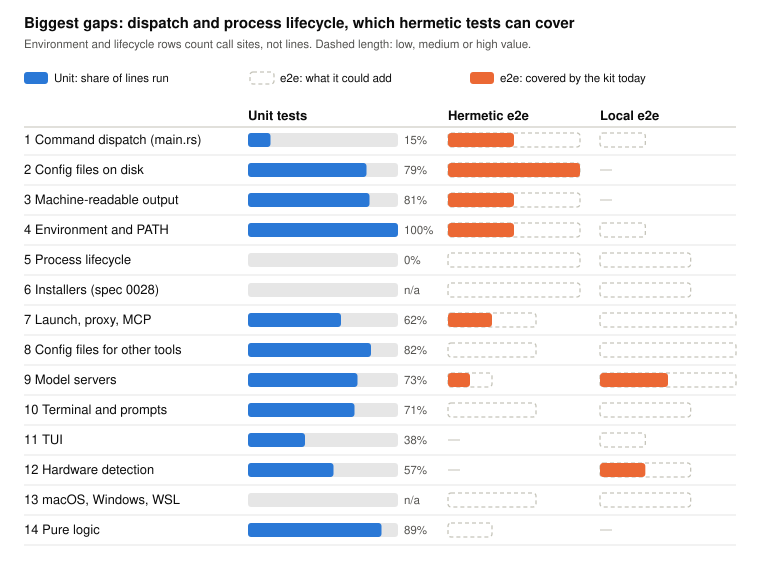
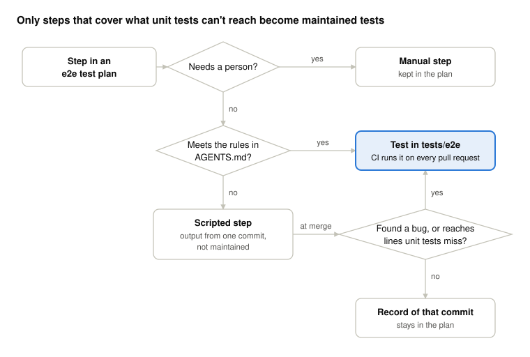
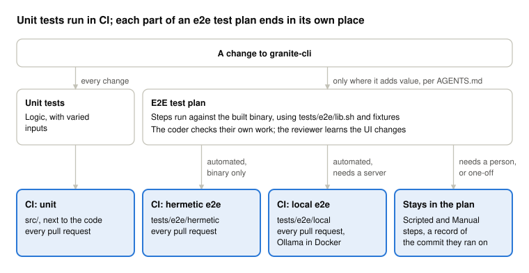

# Plan: How granite-cli Tests End to End

## Overview

Add end-to-end tests only where unit tests can't reach, add input-varied unit tests where they reach code but check it too lightly, and keep everything else in e2e test plans. Unit tests run 71% of granite-cli's code, but none of the code that turns a command line into a command, and none of its signal handling or prompts. Where they do run code, they often check it lightly: in four files mutation-tested, 29% of deliberate bugs (89 of 305) went unnoticed.

### Where unit tests stop

Unit tests call granite-cli's functions with stand-ins for the outside world: a fake terminal, a fake installer, a temporary directory. Whatever sits between the real outside world and those functions never runs in a unit test. That is what end-to-end tests are for.

*Unit-test coverage measured on main 42ae10a; e2e value is judgement*

The blue bars are measured. Command dispatch (`main.rs`) runs 15%, and `main()` itself none of its 128 lines; signals, exits and prompts run in no unit test; the proxy and MCP servers used at launch run 0–13%. Those are the rows where end-to-end tests add most. Config, environment and output code are already well run by unit tests.

### Where unit tests are thin

Running a line is not checking it. A third of the code unit tests run (31.9%) runs only 1–3 times in the whole suite, most of it in `launchers` (44%), `commands` (38%) and `utils` (32%). Mutation testing measures what that means: `cargo-mutants` makes small changes to the code, such as flipping a condition or returning a default, and counts the ones no test notices.

| File | Lines run by unit tests | Changes the tests catch | Changes no test notices |
| --- | --- | --- | --- |
| `src/models/context_fit.rs` | 98% | 94% | 5 of 81 |
| `src/launchers/opencode.rs` | 82% | 72% | 27 of 96 |
| `src/commands/launcher.rs` | 93% | 71% | 10 of 34 |
| `src/config/mod.rs` | 79% | 50% | 47 of 94 |

Coverage overstates how well the last three are checked by 10 to 29 points. The changes nobody notices fall into three groups:

- **Path translation for WSL** (`windows_to_wsl`, `translate_wsl_to_windows`, the `config_mut` translators): 29 of the 47 in `config/mod.rs`. These are pure string functions, run with one or two inputs, or not at all on Linux. Input-varied unit tests, or property tests, are the fix.
- **Reading OpenCode's own config files** (loading, finding providers, `strip_jsonc_comments`): 13 in `opencode.rs`. Files another tool writes need fixtures in its formats; a local test with the real tool would catch format changes.
- **Choices in `launcher setup`** (which capabilities, when to bind): 8 in `commands/launcher.rs`. Each condition runs, but with one combination of answers.

The well-tested logic in `context_fit.rs` is the contrast: run many times with many inputs, it catches 94%. End-to-end tests would not close these gaps: most are pure functions and conditions, where unit tests with more inputs are cheaper.

## Proposal

**Four kinds of test, each for what the one before can't do:**

| Kind | Runs | Use it for |
| --- | --- | --- |
| Unit | Every CI run | Logic, with the outside world injected. Vary the inputs where the logic branches |
| Hermetic e2e | Every CI run | Command dispatch, files on disk, environment and `PATH`, signals and child processes |
| Local e2e | Every CI run, with Ollama in Docker | Model servers, agent tools launched through the proxy, the config those tools read |
| E2E test plan | While a feature is developed | First-hand experience; the TUI, real key presses, macOS, Windows, WSL |

*What happens to each step of an e2e test plan*

### Testing a change

Every change gets unit tests. A change also gets an e2e test plan, only where one adds value, as the recommendations in `AGENTS.md` describe: steps run against the built binary with `tests/e2e/lib.sh` and the fixtures. The coder uses the plan to check their own work, and the reviewer uses it to learn the UI changes.

*Where unit tests and the parts of an e2e test plan end up*

Each step of the plan ends in one of three places: a hermetic test when it needs only the binary, a local test when it needs a model server, or the plan itself when it needs a person or is a one-off. [Proposal](#proposal) says how a step is sorted. The tests in CI run on every pull request; the steps left in the plan are a record of the commit they ran on.

## Next Steps

The rules are in `AGENTS.md` ("Which kind of test to write") and `tests/e2e/README.md`. The steps below are outside the scope of this spec.

The three automated kinds, unit, hermetic and local, all feed the coverage job, which reports each one and their combination on every pull request. Coverage only shows that a line ran, not that a test would notice it change: in [Where unit tests are thin](#where-unit-tests-are-thin), unit tests ran 79–98% of four files and still missed 29% of deliberate bugs. So next to new tests where coverage is low, the steps below measure and raise how well the code that runs is checked: mutation testing finds what the tests miss, input-varied unit tests close it, and fuzzing feeds the parsers inputs nobody wrote by hand.

- **Provider images from a mirror, tested when they change.** Done separately. The e2e-local job pulls provider images from a mirror on ghcr.io, which avoids Docker Hub rate limits and rebuilding images in every run. A pull request that changes a provider image, such as a Dockerfile in `tests/e2e/docker/`, builds that image, starts its service and runs the local tests that need it.
- **Hermetic dispatch tests.** Exit codes, stdout vs stderr, `-o json` per command group.
- **Hermetic lifecycle tests.** A sleeping stub, a signal, nothing left running.
- **Input-varied unit tests where mutation testing finds gaps.** Start with the WSL path translation and OpenCode's config parsing, then run cargo-mutants on more modules in a scheduled job, and fuzz the parsers of other tools' files. See [Where unit tests are thin](#where-unit-tests-are-thin).
- **Hermetic installer tests.** Once spec 0028 lands.
- **One local launch test.** A real agent tool through the proxy against Ollama.

## Appendix: Method and Limits

- Coverage: `cargo llvm-cov`, unit tests only, main 42ae10a, Linux. Counts product code only; the 84% often quoted also counts the test code itself, which runs at 99%.
- Mutation testing: cargo-mutants 27.1, unit tests only, main 42ae10a, 326 mutants in four files chosen for contrast, 86 minutes with 2 jobs; 21 did not compile and are left out. The e2e "could add" lengths in the chart are judgement; everything else is measured.
- Not run on macOS or Windows.
