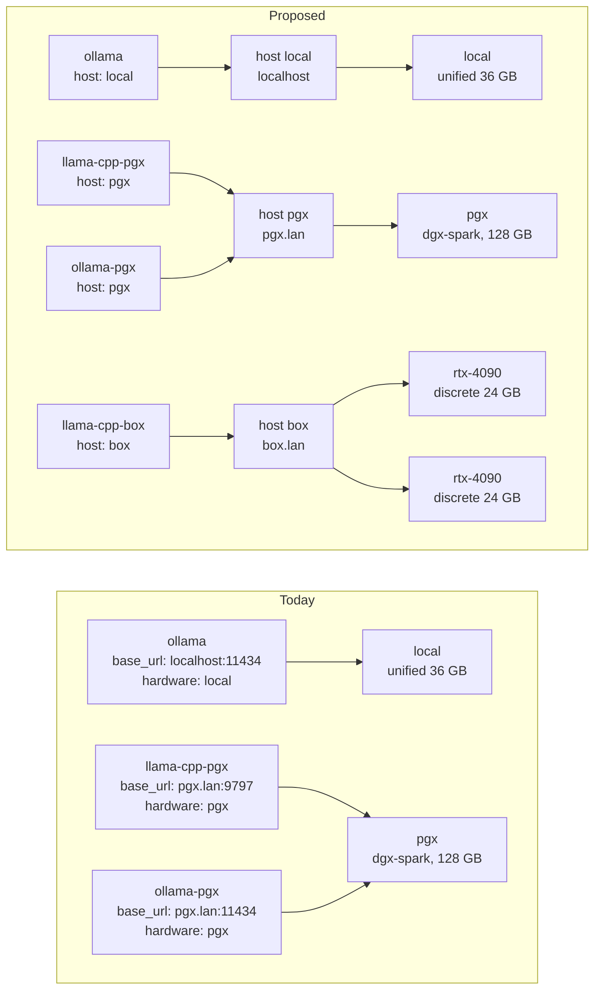
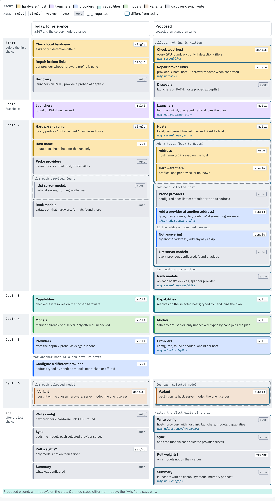
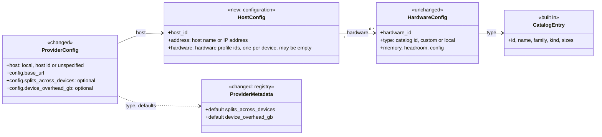
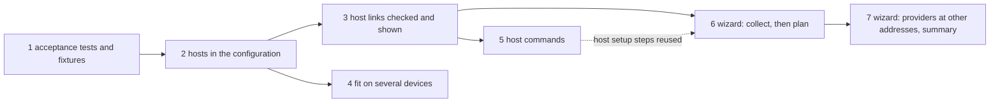

# Plan: Hosts and Setup

Follows spec 0027 (hardware profiles) and the review of its part 3 (#267).

## Overview

Spec 0027 gave each provider a link to a **hardware profile**: a description
of one device by its memory, made from the built-in catalog of devices (each
entry a **catalog card**), from typed figures, or, for `local`, from
detection on the machine granite-cli runs on. Fit, whether a model variant's
weights and context fit in memory, is estimated against the hardware profile
a provider is linked to.

The configuration has no notion of the machine a provider runs on. A
provider has a base URL and a hardware link, and a hardware profile
describes one device. This spec adds a **host**: a machine that runs model
servers, reached at an address, with the devices it has. Providers link to
the host they run on.



A host helps in four places.

- **Several GPUs in one machine.** A hardware profile describes one device,
  and detection on this machine reads the first NVIDIA device only. A box
  with two 24 GB cards is estimated as 24 GB, so a model that needs 40 GB is
  reported as not fitting, although llama.cpp, Ollama and LM Studio split a
  model across the GPUs of one machine, and vLLM does when started to. With
  hosts, a machine lists its devices and fit can use their combined memory.
- **The address of a machine.** The address is stored only in provider base
  URLs. Two providers on one machine each carry it, so a machine that
  changes address needs every provider edited by hand, and nothing checks
  that they agree. With hosts, the address is saved once.
- **The setup wizard.** The wizard asks for one hardware profile and one host
  name per run, and keeps the host name in memory only. A user with models
  on this laptop and on a remote GPU box runs setup twice, or adds the second
  machine's providers by hand, where their models are not ranked. On the
  next run the wizard offers the host found in the base URL of the first
  provider linked to the chosen hardware profile, by id. With hosts, the
  wizard offers every saved host, and one run covers several.
- **The order of the setup flow.** Some of what the wizard needs to build its
  plan is only asked after the plan is built, or is not asked at all (see
  [What the wizard asks after ranking](#what-the-wizard-asks-after-ranking)).
  A provider on a non-default port is the case reported in the review of
  #267: its models are never ranked or bound to a capability, setup reports
  success, and the launchers are left without a capability. With hosts,
  every machine and provider is known before ranking, and the wizard
  collects all of its inputs before it builds the plan.

A host also tells a server the user runs apart from a third-party service
when its hardware is unknown, and gives setup a place to add up the memory
that the models bound to one machine's providers need. Later work can attach
to it too: probing saved hosts in `setup --auto`, detecting a remote
machine's hardware, and installing or starting providers on it.

Three terms are used throughout:

- **Remote provider**: a provider the user runs on another machine.
- **Hosted provider**: a third-party service such as OpenRouter, whose
  hardware the user does not know.
- **Device**: one GPU, or one pool of unified memory, described by a
  hardware profile.

### What the wizard asks after ranking

The wizard, with spec 0027 part 3 and the change that offers the models
servers already have, asks for the hardware and a host name after the
launchers, probes the default ports of the provider types the user runs at
that host, lists the models each provider found serves, and ranks the
catalog on that hardware. The inputs below arrive after that ranking, or not
at all:

```
  input                               when it arrives today                 effect
  ─────                               ─────────────────────                 ──────
  a provider on a non-default port    "Configure a different provider…"     its models are not ranked, offered
                                      in the Providers step, after          or bound; launchers end up with no
                                      capabilities and models               capability

  a provider of a type already        never: a configured type is not       a second Ollama on a remote host
  configured, on another host         probed again                          cannot be found

  models a configured provider        never: only providers found in        a model already on a configured
  serves                              this run are listed                   server is not marked or offered

  a second host                       a second run                          models are ranked on one machine

  a capability, launcher or model     "Configure a different …" in its      saved at once, before the rest of
  typed by hand                       step                                  the plan; kept if the user quits
```

The variant of each model is also chosen after ranking. It is a decision
over the ranked models and stays where it is.

## Use Cases

Each use case is runnable once the sub-tasks below are complete.

A single local machine:

1. **First setup on a laptop.** `granite-cli setup` offers the local host,
   checked. The wizard probes this machine, ranks models on the local
   hardware, and saves providers linked to `local`, as today.
2. **`setup --auto` on a new machine.** It configures what answers on this
   machine and the hosted services, with no question asked.

A machine with several GPUs:

3. **Two cards in this machine.** On a machine with two 24 GB NVIDIA cards,
   detection writes the `local` host with two devices. A model that needs
   40 GB is ranked as fitting for llama-cpp, Ollama and LM Studio.
4. **Two cards in a remote box.** The user adds `box.lan` with the
   `rtx-4090` profile listed twice. Models are ranked on both cards for the
   providers there that split a model across devices, and on one card for
   the others.
5. **A vLLM server using both cards.** An openai-compatible provider uses one
   device by default. The user sets `splits_across_devices: true` in its
   configuration, and its models are ranked on both cards.

One remote GPU box:

6. **Add a box during setup.** The user picks "Add a host…", types `pgx.lan`,
   and picks or creates its hardware. The wizard probes `pgx.lan`, ranks
   models on that hardware, and saves the host and the providers found
   there.
7. **Add a box from the command line.** `granite-cli host setup` asks for the
   address and the hardware. `host list` and `host info pgx` show it with
   its providers.
8. **A box whose hardware is unknown.** The user adds `lab.lan` with
   hardware "unknown". The wizard probes it and offers the models its
   servers have, with fit "not available". Adding a hardware profile later
   with `host setup lab` gives fit to every provider on it.
9. **Two identical boxes.** `pgx` and `pgx2` both list the `dgx-spark`
   profile. Editing it asks whether to change it for both or create a new
   profile for one of them.

Local and remote together:

10. **Rank across both.** With `local` and `pgx` checked, the wizard probes
    both, ranks each model on every host whose providers can run it, and binds
    it where it fits best.
11. **Two providers of one type.** Ollama on the laptop and Ollama on `pgx`
    are saved as `ollama` and `ollama-pgx`.

Everything known before the plan:

12. **A server on a non-default port.** Nothing answers on the default ports
    at `pgx.lan`. The user adds llama-cpp at `http://pgx.lan:9797` in the
    hosts step. Its models are listed, ranked and offered for the selected
    capabilities like any other provider's.
13. **Models a configured server has.** Ollama is configured. The wizard
    lists what it serves, marks those catalog models "already on: ollama",
    and offers its other models.
14. **Quit before the end.** The user adds a capability by hand and quits at
    the variants step. Nothing is written.
15. **Know when something is missing.** When a launcher ends up with no
    capability, the summary says which and why.
16. **Know when models compete for memory.** Two models bound to providers
    on `pgx` need 150 GB together. The summary says they cannot all be
    loaded at once.

Running setup again:

17. **Hosts are remembered.** Configured hosts are offered checked, with their
    addresses. Providers already configured at a host are listed, not probed
    again.
18. **Move a box.** `granite-cli host setup pgx --address 10.0.0.12` changes
    the address and offers to update the base URLs of the providers on it.
19. **Upgrade.** A provider file written by spec 0027 does not load. The
    error names the file and the conversion in the release notes, which
    writes the hosts and rewrites the providers.

## Proposal

A **host** is a machine that runs model servers. It has an id, an address (a
host name or an IP address) and a list of devices, each a hardware profile;
the list is empty when the hardware is unknown. A provider links to the host
it runs on, and fit is estimated on that host's devices: on one device, or,
for a provider that splits a model across devices, on all of them together.
`local` is the host granite-cli runs on, and detection lists each of its
GPUs. The setup wizard asks which hosts to use, collects every provider on
them, including ones at non-default addresses, and every model they serve,
and only then ranks models and builds the plan, which it writes at the end.

### Design decisions

In order of how much of the design depends on them.

1. **A provider links to a host, and the host holds the address.** The
   provider's `hardware:` field becomes `host:`, with the values `local`, a
   host id, or `unspecified`. The address of a machine is saved once, on its
   host, and the wizard and `provider setup` build a provider's base URL from
   it.

2. **A host lists its devices as hardware profiles, or none.** The hardware
   profile stays what spec 0027 made it: one device and its memory, from the
   catalog, typed figures or detection. A host names its devices by hardware
   profile id. Two identical cards are the same id listed twice, and two
   identical boxes can list the same id. A host with no devices has unknown
   hardware: it is probed and its models are offered, with fit "not
   available". Hardware profiles stay their own files, so a profile with no
   host still answers `model recommend --hardware dgx-spark`.

3. **Fit on a host uses one device, or all of them for a provider that
   splits.** Whether a provider splits a model across the devices of one
   machine, and the memory it loses on each extra device, are provider
   settings with defaults from its type. For a provider that splits, a model
   fits if it fits in the combined usable memory of the host's devices, less
   the overhead for each device after the first. For any other provider, or
   a host with one device, fit uses the largest device, as today. A host
   lists devices of one memory kind.

4. **Detection on this machine lists every GPU.** The `local` host lists one
   device per GPU detection finds. A Mac, or a machine with unified memory,
   has one device.

5. **The wizard collects all of its inputs before it builds the plan.** Hosts,
   providers at default and other addresses, the models every selected
   provider serves, configured or found, and items typed by hand are all
   gathered before models are ranked. Items typed by hand become part of the
   plan, and nothing is written until the end of the run.

6. **One run covers several hosts.** The hosts step is a multi-select. The
   wizard ranks each model on every selected host whose providers can run
   it, and binds it to the provider where it fits best, as spec 0027 does
   across providers.

7. **`local` is a host.** It is reserved, has the address `localhost`, and
   lists the devices detection finds. It is written the first time it is
   needed, as the `local` hardware profile is today.

8. **Configuration from spec 0027 is converted outside the binary.** A
   provider file with `hardware:` does not load, with an error that names the
   file and the conversion in the release notes. The conversion is a script
   published with the release; granite-cli has no conversion code.

9. **Setup says what the plan leaves out or overcommits.** The summary names
   each launcher left without a capability and the capability that did not
   resolve, and each host whose bound models need more memory together than
   it has.

### Hosts and their devices

A host has an id, an address and a list of hardware profile ids.

```yaml
# hosts/pgx.yaml
host_id: pgx
address: pgx.lan
hardware:
  - pgx
```

```yaml
# hosts/box.yaml
host_id: box
address: box.lan
hardware:
  - rtx-4090
  - rtx-4090
```

The address is a host name or an IP address, checked as the wizard checks it
today. A host id follows the hardware profile id rules from spec 0027: it
starts with a letter or digit and uses only letters, digits, `-`, `_` and
`.`. `local` is reserved. Two hosts cannot have the same address.

```yaml
# hosts/lab.yaml: hardware not known yet
host_id: lab
address: lab.lan
hardware: []
```

Each entry in the `hardware` list names a configured hardware profile, and
the same id can appear more than once. The entries must have the same memory
kind; a host with a discrete card and a unified device does not load, with
an error that names the file. The `local` hardware profiles can only be
listed by the `local` host, since their figures come from detection on this
machine. Other profiles can be listed by several hosts.

A host with an empty list is still probed by the wizard, and its providers'
models are listed and can be picked as server models. Fit for its providers
is "not available", and ranking leaves them out, as it does for hosted
providers. `host: unspecified` then means a third-party service only, which
tells a self-hosted openai-compatible server, such as vLLM, from a hosted
API.

### Fit on several devices

Spec 0027 estimates fit against one hardware profile's usable memory: the
memory figure divided by the headroom for its kind. On a host, the memory a
provider can use is:

```
  provider splits a model   host devices   memory for fit
  ───────────────────────   ────────────   ──────────────
  no                        any            the largest device's usable memory
  yes                       1              that device's usable memory
  yes                       n > 1          sum of the devices' usable memory,
                                           less (n − 1) × device_overhead_gb
  either                    none           nothing: "fit not available"
```

The per-device overhead covers the compute buffers each GPU holds for its
share of the model, and the layers not dividing evenly across devices. Two
optional fields in the provider configuration set the behaviour, with
defaults from the provider type in the registry:

```yaml
# providers/vllm-box.yaml
provider_id: vllm-box
type: openai-compatible
host: box
config:
  base_url: http://box.lan:8000/v1
  splits_across_devices: true   # vLLM started with --tensor-parallel-size 2
  device_overhead_gb: 1.0
```

```
  type                splits by default   why
  ────                ─────────────────   ───
  llama-cpp           yes                 splits by layer across visible GPUs
  ollama              yes                 one GPU when the model fits, otherwise all
  lm-studio           yes                 runs GGUF on llama.cpp, fills GPUs in order
  mlx                 n/a                 Apple unified memory: one device
  openai-compatible   no                  vLLM splits only when started with
                                          --tensor-parallel-size; not visible
                                          through the API
```

`device_overhead_gb` defaults to 1 GB for every type. The llama.cpp load logs
published in its issues show 0.3 to 0.6 GB of compute buffer per device,
depending on the backend and batch size, so 1 GB keeps the estimate on the
low side; a figure measured on a two-GPU machine can replace it. A default
of "no" for openai-compatible gives a vLLM server that splits a fit that is
too low until the user sets the field. Hosted types have no host.

With two `rtx-4090` profiles of 24 GB, a llama-cpp provider, and an
openai-compatible provider that keeps the default:

```
$ granite-cli model recommend --host box
MODEL              VARIANT  FIT                     PROVIDERS
granite-4.2-30b    Q8_0     Full on box (2 × 24 GB) llama-cpp-box
granite-4.2-30b    Q8_0     None on box (24 GB)     openai-box
```

Devices of different sizes, such as a 24 GB and a 12 GB card, are summed
the same way; llama.cpp and Ollama divide the layers by each card's memory.
The estimate does not model speed: a model split over PCIe fits, and the
spec makes no claim about how fast it runs.

### Detecting several GPUs on this machine

Detection on this machine reads one device per vendor today: NVML device 0,
the first AMD card in sysfs, the Metal device, or the first DXGI adapter.
It reads every device instead, and the `local` host lists one hardware
profile per GPU found: `local` for the first, `local-2`, `local-3` and so on
for the others. The check before setup's first question compares the
devices found with the saved ones, and asks as today when they differ. A
machine with no GPU, or with unified memory, has one device, `local`, and
nothing changes for it.

```
$ granite-cli host info local
Host: local
Address: localhost
Devices:
  local     NVIDIA discrete 24 GB (detected)
  local-2   NVIDIA discrete 24 GB (detected)
Providers: ollama, llama-cpp
```

### Linking a provider to its host

A provider stores the host it runs on. The values and defaults follow spec
0027's hardware link:

```
  link            stored as           default for                  fit is estimated against
  ────            ─────────           ───────────                  ────────────────────────
  local           host: local         providers the user runs      the local host's devices
  a host          host: pgx           (chosen by the user)         the host's devices
  not specified   host: unspecified   hosted providers             nothing: "fit not available"
  not set         (no host line)      providers configured         the local host's devices
                                      before spec 0027
```

```yaml
# providers/llama-cpp-pgx.yaml
provider_id: llama-cpp-pgx
type: llama-cpp
host: pgx
config:
  base_url: http://pgx.lan:9797
  discover_models: true
```

The provider keeps its full base URL, so sync, launch and the provider
implementations read the configuration as they do today. The wizard and
`provider setup` write the base URL with the host's address. The validation
from spec 0024 checks the link: the host must exist, and its hardware
profiles must exist and be usable. A base URL whose host part differs from
the host's address is a warning in `provider list` and `provider info`,
since the provider may be reached through another name for the same
machine. When the host's address changes, `host setup` offers to rewrite the
base URLs (see [Host commands](#host-commands)).

`provider setup` asks for the host where it asked for the hardware. It
offers `local`, the configured hosts, "not specified", and "create new
host…", which runs the `host setup` steps. The endpoint question then
defaults to the type's default URL at the host's address.

```
$ granite-cli provider setup llama-cpp
? Host:
    local (this machine, unified 36 GB)
  › pgx (pgx.lan, dgx-spark, unified 128 GB)
    create new host…
    not specified
? Instance name: llama-cpp-pgx
? Endpoint: http://pgx.lan:9797
✓ Provider 'llama-cpp-pgx' configured (host: pgx)
```

```
$ granite-cli provider list
Configured Providers (4 providers)
ID             TYPE        ENDPOINT                   HOST    NOTES
ollama         ollama      http://localhost:11434     local
ollama-pgx     ollama      http://pgx.lan:11434       pgx
llama-cpp-pgx  llama-cpp   http://pgx.lan:9797        pgx
openrouter     openrouter  https://openrouter.ai/api  hosted
```

### Host commands

`host` is a command group with `list`, `info`, `setup` and `remove`, and
takes `--output` like the other groups. The `hardware` commands keep
managing hardware profiles; `hardware list` gains a HOSTS column, and
`hardware remove` lists the hosts that use a hardware profile before
removing it. `model recommend` gains `--host`, which estimates fit on that
host's devices for each provider there and conflicts with `--hardware`;
`--hardware` keeps estimating on one device.

```
$ granite-cli host list
Configured Hosts (3 hosts)
ID     ADDRESS    DEVICES                          PROVIDERS
local  localhost  local (unified 36 GB)            ollama
pgx    pgx.lan    pgx (dgx-spark, unified 128 GB)  ollama-pgx, llama-cpp-pgx
box    box.lan    2 × rtx-4090 (discrete 24 GB)    llama-cpp-box
lab    lab.lan    unknown                          vllm-lab
```

`host setup` asks for the address, then the devices, then the id. The
devices question offers the configured hardware profiles other than the
`local` ones, "create new profile…", which runs the `hardware setup` steps,
and "unknown", which saves the host with no devices. After a profile it asks
how many of that device the host has. The id defaults to the first label of
a host name (`pgx` for `pgx.lan`), and to the first hardware profile id, or
`host`, for an IP address. `--address` and `--hardware`, which can be
repeated or left out for unknown hardware, answer the questions in scripts.

```
$ granite-cli host setup
? Host name or IP address: box.lan
? Hardware on box.lan:
  › create new profile…
? Hardware family: NVIDIA GeForce
? Card: RTX 4090 (24 GB)
? Profile id: rtx-4090
✓ Hardware profile 'rtx-4090' configured
? How many of these on box.lan? 2
? Host id: box
✓ Host 'box' configured (box.lan, 2 × rtx-4090)
```

`host setup` with the id of an existing host asks before replacing it, as the
other `setup` commands do. When the address changes, it lists the providers
on that host whose base URL uses the old address and offers to rewrite them:

```
$ granite-cli host setup pgx --address 10.0.0.12
? Update the address in 2 providers on 'pgx'?
    ollama-pgx     http://pgx.lan:11434  →  http://10.0.0.12:11434
    llama-cpp-pgx  http://pgx.lan:9797   →  http://10.0.0.12:9797
> Yes
  No
✓ Host 'pgx' configured (10.0.0.12, hardware: pgx)
```

A run that cannot prompt saves the new address and leaves the base URLs as
they are; `provider list` then shows the address mismatch warning for each
of them.

`host remove` lists the providers linked to the host and offers the usual
choices from spec 0024. `local` cannot be removed or set up by hand; its
devices follow detection, and each can be changed with `hardware setup`.

**Editing a shared hardware profile.** A profile listed by several hosts, or
more than once on one host, is shared. Editing it asks whether to change it
for every use or to create a new profile for some of them. From `host setup`,
the new profile is for that host, and for a profile listed more than once
there the wizard asks which devices:

```
$ granite-cli host setup box
? Hardware on box.lan: rtx-4090 (2 devices)
⚠ 'rtx-4090' is used by box (device 1), box (device 2) and pgx2.
? Edit the shared profile, or create a new one for box?
  › Edit the shared profile
    Create a new profile for box
? Which devices on box use the new profile?
  [x] device 1
  [ ] device 2
```

From `hardware setup rtx-4090`, no host is named, so the wizard lists every
use and the user picks which ones move to the new profile. The others keep
the shared one:

```
$ granite-cli hardware setup rtx-4090
⚠ 'rtx-4090' is used by box (device 1), box (device 2) and pgx2.
? Edit the shared profile, or create a new one?
    Edit the shared profile
  › Create a new profile
? Which uses move to the new profile? [SPACE]
  [ ] box (device 1)
  [ ] box (device 2)
  [x] pgx2
? Profile id: rtx-4090-pgx2
```

### The setup wizard

The wizard runs in three phases: it collects its inputs, builds the plan
from them, and writes the plan. Every question whose answer changes the
ranking is asked in the first phase.

```
  phase      steps                                                writes
  ─────      ─────                                                ──────
  collect    local check and repairs, launchers, hosts, probe     nothing
             each host, providers at other addresses, models
             every selected provider serves
  plan       rank, capabilities, models, providers, variants      nothing
  write      hosts, providers, models, capabilities, launchers;   everything, at the end
             sync, pull, summary
```

The order of the steps follows the one agreed in the review of #267 (local
checks, launchers, then where models run, then capabilities, models,
providers and variants). The image shows it next to today's wizard:



Each row is a decision depth: the n-th decision the user makes, counting a
"for each" group as one. The colour of a step says what it is about, and the
badge how it asks. Dashed boxes repeat per item.

**Before the first question.** The wizard checks the `local` host's devices
against detection as spec 0027 does for the `local` profile, and offers to
repair each broken link: a provider whose host is gone, and a host whose
hardware profile is gone. It then finds the launchers on PATH. Repairs are
written when the user confirms them, as today, since they fix the
configuration the rest of the run reads.

**Launchers.** Unchanged. A launcher typed by hand through "Configure a
different launcher…" is added to the plan.

**Hosts.** The wizard lists the `local` host, each configured host and the
hosted services, all checked, followed by "Add a host…". Unchecking a host
leaves it out of this run; it is not removed. Unchecking the hosted services
skips probing them.

```
? Hosts to run models on [SPACE]
  [x] local            localhost  local (unified 36 GB)
  [x] pgx              pgx.lan    pgx (dgx-spark, unified 128 GB)
  [x] hosted services             openrouter
  [ ] → Add a host…
```

"Add a host…" runs the `host setup` steps and returns to the list with the
new host checked.

**Probing each host.** For each selected host, the wizard lists the
configured providers on it and health-checks the default URLs of the
provider types the user runs, with the host part replaced by the host's
address. A type that is configured on another host is probed here too; a
default URL a configured provider already uses is not probed again. It
prints what answered, then asks whether to add a provider at another address
on that host. The question defaults to "No, continue" when something
answered, and to the first type otherwise.

```
Looking for providers on localhost...
  ollama      http://localhost:11434   configured, serves 3 models
Looking for providers on pgx.lan...
  nothing answered on the default ports
? Add a provider on pgx.lan at another address?
  › llama-cpp
    lm-studio
    ollama
    openai-compatible
    No, continue
? Address of the llama-cpp server: http://pgx.lan:9797
  llama-cpp   http://pgx.lan:9797      serves 2 models
? Add a provider on pgx.lan at another address? No, continue
```

The address starts as the type's default URL at the host's address, so the
user edits the port. An address whose host part is not this host's address
is refused with a message that names "Add a host…". The type's other
`provider setup` questions, such as an API key, are asked after the address.
When the address does not answer:

```
⚠ llama-cpp is not answering at http://pgx.lan:9797.
? What would you like to do?
  › Try another address
    Add it anyway (models not listed)
    Skip
```

A provider added anyway is offered in the Providers step and ranked by the
formats its type can run, with no models listed from it. For the hosted
services, the same question offers the hosted types and openai-compatible,
with an address the user types and the link "not specified".

Each provider on a selected host, configured, found or added, is then asked
which models it serves.

**Ranking.** Each catalog model variant is estimated against each selected
host whose providers can run it, on the memory each provider can use there
(see [Fit on several devices](#fit-on-several-devices)). A provider on a
host is identified by its id, so the same type on two hosts counts as two
providers. Providers on a host with unknown hardware are not ranked; the
models they serve are still offered.

**Capabilities and models.** As today, over the providers of all selected
hosts. A catalog model a server has is marked with that provider, and server
models not in the catalog are offered unchecked. A capability or model typed
by hand through "Configure a different …" is added to the plan.

```
? Select models to configure [SPACE]
  [x] granite-4.2-30b   Q8_0    Full on pgx              already on: llama-cpp-pgx
  [x] granite-4.2-8b    Q4_K_M  Full on local            already on: ollama
  [ ] unsloth/Qwen3.6-35B-A3B-GGUF:Q4_K_M                served by: llama-cpp-pgx
  [ ] → Configure a different model…
```

**Providers.** The providers configured, found or added on the selected
hosts. A provider found on the `local` host keeps its type as its id. A
provider found on another host gets `<type>-<host id>`, such as
`ollama-pgx`. When that id belongs to a provider at another address, the
wizard asks for an id. The list has no "Configure a different provider…"
item; providers are added in the hosts step.

**Variants.** Unchanged: the best fit on the host the model is bound to, or
the variant a server already has.

**Writing, sync and pull.** The wizard writes the hosts added in this run,
then the providers with their host link and address, then the launchers,
models and capabilities, including those typed by hand. Sync and pull run as
today; pull skips models already on their server. If the user quits before
this point, nothing from the run is written.

**Summary.** A launcher with no enabled capability is named, with the
capability its recommended configuration asks for and why it did not
resolve. For each host, the wizard adds up the variant sizes of the models
bound to capabilities on its providers, and when the total is more than the
host's combined usable memory it says so. It is information: whether the
models run at the same time is not known, and switching between them
reloads weights, which takes time. A model with no known size is left out of
the total, and the line says so; a host with unknown hardware is skipped.

```
=== Setup Complete ===
Hosts: local, pgx
Providers: ollama, ollama-pgx, llama-cpp-pgx
Models: granite-4.2-8b, granite-4.2-30b, gpt-oss-120b
Launchers: opencode, claude
Capabilities: agent-model (opencode), coder-model (opencode)
⚠ Launcher 'claude' has no capability: its recommended 'agent-model' did not
  resolve to a selected model. Run `granite-cli capability setup` to bind one.
ℹ pgx: models bound here total 150 GB, usable memory is 128 GB.
  They cannot all be loaded at once; switching between them reloads weights.
```

### `setup --auto`

`setup --auto` probes the `local` host and the hosted services, as today, and
links the providers it adds to `local` or "not specified" by type. It writes
the `local` host, with its detected devices, when it is missing. It does not
probe other configured hosts; a follow-up can add that, since their
addresses are saved. Its output has the same launcher and memory lines as
the wizard's summary.

### TUI

The TUI reads the provider link through the host. For a host with one
device, fit in the Recommend section is unchanged; for a host with several,
it shows the memory the provider type can use there. A Hosts section is not
part of this spec (see Out of Scope).

### Upgrading from spec 0027

A provider file that still has `hardware:` does not load:

```
✗ providers/llama-cpp-pgx.yaml: 'hardware' was replaced by 'host' in
  granite-cli 0.N. Convert the configuration with the script in the release
  notes: https://github.com/ibm-granite-community/granite-cli/releases/tag/v0.N
```

The script is kept in `scripts/` and linked from the release notes. For each
hardware profile other than `local` that a provider links to, it writes a
host with the same id, that profile as its one device, and the address from
those providers' base URLs, and it rewrites each provider's `hardware:` as
`host:`. Providers linked to the same hardware profile at different
addresses get one host per address (`pgx`, `pgx-2`). `local` and
`unspecified` map to themselves. It prints what it wrote, and changes
nothing when run a second time.

### Data model



Arrows are references stored in configuration, in the catalog or in the
registry.

Hosts are saved one file per host under `hosts/`, loaded and saved like the
other kinds. The provider's link changes type from a hardware link to a host
link with the same three values, and the loader refuses a provider file that
still has `hardware:`. Fit takes a host's devices and the provider's split
setting and overhead where it took one hardware profile. The wizard's
in-memory link (`AppContext::setup_link`) is replaced by the hosts selected
in the run. The reference checks of spec 0024 gain two kinds: a provider's
host, and a host's hardware profiles. `docs/data-model.md` gains the host
between providers and hardware profiles.

## Test Strategy

The spec is implemented when the acceptance tests in this section exist and
pass in CI, and the manual test guide has been run once on real hardware.
The acceptance tests are written from the use cases, and each one names the
use case it proves. The "Tests cover" list of each sub-task adds the unit
tests behind them; those check parts, and the acceptance tests check that
the parts give the behaviour a user sees.

### Test levels

```
  level           where                               runs in CI                 drives
  ─────           ─────                               ──────────                 ──────
  in-process      src/, #[cfg(test)]                  check job, every run       the interactive wizard and prompts,
                                                                                 through CaptureUi's canned answers,
                                                                                 against fake provider servers

  hermetic e2e    tests/e2e/hermetic/                 e2e job                    the binary, from fixtures: commands
                                                                                 that do not prompt, files written,
                                                                                 exit codes, JSON output

  local e2e       tests/e2e/local/                    e2e-local job, Ollama      probing and sync against a real
                                                      in Docker, --no-skip       provider server

  manual          tests/e2e/manual/hosts-and-setup.md once, before the last     two GPUs, a remote box, the wizard
                                                      sub-task merges            in a terminal, the TUI
```

The wizard asks its questions through the `Ui` trait, and only in-process
tests can answer them, so the wizard's acceptance tests are in-process. They
run the whole wizard, from the first question to the summary, against a
temporary configuration home, and check the files it writes. No acceptance
test depends on the machine it runs on, as AGENTS.md requires: detection is
fed findings, the `local` hardware profile in fixtures is in manual mode,
and provider servers are fakes on the loopback address.

### Fixtures and helpers

- **A fake provider server** in `src/utils/test_support.rs`. It serves the
  health and model-list endpoints of ollama, llama-cpp and lm-studio with a
  given list of models, on an ephemeral port of the loopback address, and
  counts the requests it receives. It generalizes the Ollama server the
  server-models change added to the setup tests.
- **Default ports a test can set.** The wizard probes each type's default
  URLs from the provider registry, and a fake server on an ephemeral port is
  not at a default URL. The wizard reads the default URLs through
  `AppContext`, which returns the registry's values unless a test has set
  others, so a test can put "the default port" of a type on its fake server.
  Configured providers and providers added at another address need no
  setting: the test writes the fake server's URL in the configuration or
  types it as the answer.
  The environment variable `GRANITE_CLI_TEST_DEFAULT_BASE_URL` replaces the
  default URLs of every type in the binary, so a hermetic test can run
  `setup --auto` without reaching a server on the machine or a hosted
  service.
- **Two hosts in one test** are `localhost` and `127.0.0.1`: two addresses,
  which the wizard keeps apart, that both reach the test's fake servers. No
  test needs a second machine or a network.
- **The `hosts` e2e fixture**: the `local` host in manual mode; `pgx` and
  `pgx2` sharing the `dgx-spark` profile; `box` listing `rtx-4090` twice, with
  a llama-cpp provider, an openai-compatible provider that keeps the default
  (`openai-box`), and one that sets `splits_across_devices: true`
  (`vllm-box`); and `lab` with no hardware.
- **The `spec0027` e2e fixture**: providers linked with `hardware:` to
  `local`, `unspecified`, one profile shared by two providers at one address,
  and one profile at two addresses.
- **The manual guide** `tests/e2e/manual/hosts-and-setup.md`, from the
  template, with the steps that need real hardware.

### Acceptance tests

Each use case has at least one acceptance test. The sub-task column says
which sub-task makes it pass.

```
  use case                           test                                                    level        sub-task
  ────────                           ────                                                    ─────        ────────
  1 first setup on a laptop          wizard_local_host_only                                  in-process   6

  2 setup --auto on a new machine    local/setup-auto-ollama.sh: hosts/local.yaml written,   local e2e    6
                                     ollama has host: local

  3 two cards in this machine        detection_two_gpus_two_local_devices,                   in-process   4
                                     recommend_on_local_two_devices;
                                     manual guide, step "two GPUs"                           manual

  4 two cards in a remote box        hermetic/hosts-fit.sh: model recommend --host box,      hermetic     4
                                     llama-cpp-box on 2 × 24 GB, openai-box on 24 GB

  5 a vLLM server using both cards   hermetic/hosts-fit.sh: vllm-box on 2 × 24 GB            hermetic     4

  6 add a box during setup           wizard_add_host_probes_its_address                      in-process   6

  7 add a box from the command line  hermetic/host-commands.sh: host setup --address         hermetic     5
                                     --hardware, host list, host info

  8 a box whose hardware is unknown  hermetic/host-commands.sh: host setup without           hermetic     5
                                     --hardware, "unknown" in host list, fit not available;
                                     wizard_unknown_hardware_offers_served_models            in-process   6

  9 two identical boxes              hermetic/host-commands.sh: hardware list HOSTS          hermetic     5
                                     pgx, pgx2;
                                     edit_shared_profile_new_profile_for_one_host,           in-process   5
                                     edit_shared_profile_pick_uses

  10 rank across both                wizard_binds_model_where_it_fits_best                   in-process   6

  11 two providers of one type       wizard_same_type_on_two_hosts_two_ids                   in-process   6

  12 a server on a non-default port  wizard_provider_at_other_address_is_ranked_and_bound:   in-process   7
                                     the case from the #267 review, ending with a launcher
                                     that has a capability

  13 models a configured server has  wizard_marks_models_on_configured_provider              in-process   6

  14 quit before the end             wizard_quit_writes_nothing: the configuration home is   in-process   6
                                     the same tree before and after

  15 know when something is missing  hermetic/setup-summary.sh: setup --auto with a stub     hermetic     7
                                     launcher and no provider names it;
                                     wizard_summary_names_launcher_without_capability        in-process   7

  16 know when models compete        wizard_summary_memory_over_host                         in-process   7

  17 hosts are remembered            wizard_offers_configured_hosts_and_skips_their_urls:    in-process   6
                                     the fake server for a configured provider gets no
                                     health check

  18 move a box                      hermetic/host-commands.sh: a run that cannot prompt     hermetic     5
                                     keeps the URLs and provider list warns;
                                     host_setup_address_change_rewrites_when_accepted        in-process   5

  19 upgrade                         hermetic/upgrade-0027.sh: the error names the file and  hermetic     2
                                     the release notes; the script converts; model
                                     recommend gives the same rows as before; a second run
                                     changes nothing
```

The four hermetic scripts are written in sub-task 1, before the code they
test. Each starts with `skip "spec 0033 sub-task N"`, so `run.sh` reports it
as skipped, and the sub-task named in the table removes that line. The
in-process tests use types that do not exist before their sub-task, so each
is written in the sub-task the table names.

### Definition of done

- Every test in the acceptance table exists under the name given, or a name
  the sub-task's commit message gives in its place.
- `cargo test`, `tests/e2e/run.sh --no-skip hermetic/` and
  `tests/e2e/run.sh --local --no-skip local/` pass in CI. With `--no-skip`, a
  hermetic script that still has its skip line fails.
- The tests that existed before this spec pass, changed only where the spec
  changes the behaviour they check, such as `hardware:` becoming `host:`.
- The manual guide has been run once on a machine with two GPUs and with one
  remote host, and the result is in the pull request of the last sub-task.

## Open Questions

1. **The per-device overhead figure.** `device_overhead_gb` defaults to 1 GB,
   above the 0.3 to 0.6 GB of compute buffer per device in the llama.cpp
   load logs I found. A measurement on a two-GPU machine, with llama-cpp and
   Ollama, can replace the default before or after this spec lands. I have
   not found an official figure.

## Out of Scope

- Running one model across several hosts. It needs a fast network between
  the machines and its own design.
- A provider that can use only some of its host's devices, such as a server
  in a VM with one GPU passed through. The spec assumes every provider on a
  host can use all of the host's devices.
- The operating system of a host. VMs on one host can serve on the same
  address at different ports, so an address can have several operating
  systems. Limiting formats by operating system is not modelled (#225,
  closed).
- Estimating speed: a model split over PCIe and one split over NVLink have
  the same fit.
- Hosts with devices of different memory kinds.
- Detecting the hardware of a remote host, or logging in to it.
- Finding hosts on the network, or scanning ports other than each type's
  defaults.
- `setup --auto` probing configured remote hosts.
- Installing or starting providers on a remote host (spec 0028 covers this
  machine).
- A Hosts section in the TUI, and host selection in the Recommend section.

## Considered Alternatives

**A host name field on the hardware profile.** It would add the address
with the least change: no new kind, and the provider link stays as spec 0027
made it. A hardware profile made from a catalog card describes a kind of
device, so two identical boxes would need two profiles with the same
figures, and a profile made to ask "would a Spark be enough?" would have an
address field with nothing to put in it. Several devices on one machine
would need several profiles with the same address and nothing tying them
together.

**A device count on the hardware profile.** A profile could say "2 ×
rtx-4090". Two boxes with one card each would then share a profile with a
box that has two, and the count would not say which providers can use both.
The count would also be a second way of describing a machine next to the
host.

**Converting spec 0027 configuration in granite-cli.** The loader could write
the hosts and rewrite the providers on first use, or read both formats. The
code would stay in the binary for a format that exists for a few releases,
and reading both formats would keep two kinds of link in every command that
reads them. A script published with the release does the same conversion
once.

**Requiring at least one device on every host.** A user who does not know a
box's hardware would pick a custom profile with a guess, or link its
providers to "not specified" with their full URLs. A self-hosted
openai-compatible server would then look the same as a hosted API, the
wizard could not probe the box, and its providers would carry the address
separately.

**Keeping the host in memory for the run.** This is what #267 does. The host
is asked after the hardware and used to probe providers; on the next run it
is offered again from the base URL of the first provider linked to that
hardware. It needs no change to the configuration format, and it covers one
machine per run, with the address still stored only in provider base URLs.

---

## Sub-Tasks

Each sub-task is one commit, or one pull request, that leaves `main` working,
with its tests and documentation. Sub-task 1 adds the acceptance tests and
their fixtures, with the hermetic scripts skipped. Sub-task 2 changes the
configuration with no visible change other than the error for a spec 0027
provider file. Sub-task 4 can run in parallel with 5 to 7.



---

### Sub-Task 1 — Acceptance tests and fixtures

**Intent**
Write down what done means for this spec as tests, before the code they
test.

**Expected Outcomes**

The `hosts` and `spec0027` fixtures exist under `tests/e2e/fixtures/`. The
wizard reads the default URLs of the provider types through `AppContext`,
and tests can set them. The hermetic scripts `upgrade-0027.sh`,
`hosts-fit.sh`, `host-commands.sh` and `setup-summary.sh` exist with every
step of the acceptance table that they own, and each starts with `skip "spec
0033 sub-task N"`, so `run.sh` reports them as skipped and CI stays green.
`src/utils/test_support.rs` has the fake provider server for ollama,
llama-cpp and lm-studio, and the setup tests that used the Ollama server
from the server-models change use it instead. The manual guide
`tests/e2e/manual/hosts-and-setup.md` exists with the steps for two GPUs, a
remote host and the TUI. No behaviour changes.

Tests cover: the fake server answering the health and model-list request of
each type, counting requests, and refusing on a closed port; the wizard
probing a default URL a test has set; the existing setup tests passing on
the shared server; `shellcheck -x` passing on the new scripts; and `run.sh`
listing the four scripts as skipped with their sub-task.

**Relevant Context**
- `tests/e2e/README.md`, `tests/e2e/lib.sh` (`use_fixture`, `skip`,
  `expect_same_tree`), `tests/e2e/manual-test-template.md`
- `src/utils/test_support.rs`
- `src/commands/setup.rs` (the Ollama server in the setup tests)
- [Test Strategy](#test-strategy)

**Status** — `[x]` done

---

### Sub-Task 2 — Hosts in the configuration

**Intent**
Save hosts, link providers to hosts, and estimate fit through the host,
with a script that converts spec 0027 configuration.

**Expected Outcomes**

The configuration gains a hosts directory, loaded and saved like the other
kinds. A host saves its id, address and a list of hardware profile ids,
which may be empty and may repeat an id; a list that mixes memory kinds
fails to load with an error that names the file. The `local` host is written
on first use with the address `localhost` and the `local` hardware profile,
and cannot be removed. A provider's `hardware:` field becomes `host:`, with
the values `local`, a host id and `unspecified`, and a provider with neither
field still reads as `local (not set)`. A provider file with `hardware:`
fails to load, with an error that names the file and the release notes. Fit
for a provider is estimated on the largest device of its host, and is "not
available" on a host with no devices, so every estimate for a converted
configuration stays the same. A script in `scripts/` converts a spec 0027
configuration as [Upgrading from spec 0027](#upgrading-from-spec-0027)
describes. `docs/data-model.md` shows the host.

Tests cover: a host round-tripping through YAML, with one device and with the
same profile listed twice, and with none; mixed memory kinds failing to
load; a provider file with `hardware:` failing to load with the message;
`local` written on first use and refused on removal; fit for a provider on a
host matching fit for the same provider linked to that hardware profile
before, and "not available" on a host with no devices; a provider with no
link read as `local (not set)`; and the script converting a spec 0027
configuration with `local`, `unspecified`, one profile shared by two
providers at one address, and one profile at two addresses, then changing
nothing on a second run. The script's test runs it on a fixture directory.
`hermetic/upgrade-0027.sh` loses its skip line and passes.

**Relevant Context**
- `src/config/hardware.rs` (`HardwareLink`, `HardwareConfig`)
- `src/config/mod.rs` (`ProviderConfig`, `load_dir`, `hardware_dir`)
- `src/context.rs` (`hardware_profile`, `ensure_local_hardware`)
- `docs/data-model.md`

**Status** — `[x]` done

---

### Sub-Task 3 — Host links are checked and shown

**Intent**
Check host links like the other references, and show and ask for the host
where the provider commands showed the hardware.

**Expected Outcomes**

The validation from spec 0024 checks that a provider's host exists and that
a host's hardware profiles exist and are usable, and the remediation prompt
offers repairs for both. A provider whose base URL host differs from its
host's address is a warning in `provider list` and `provider info`.
`provider setup` asks for the host, offering `local`, the configured hosts,
"not specified" and "create new host…", and defaults the endpoint to the
type's default URL at the host's address. `provider list` shows a HOST
column. `hardware list` shows a HOSTS column, and `hardware remove` lists
the hosts that use a hardware profile. `model recommend --hardware` lists
the providers on hosts with that hardware profile.

Tests cover: a missing host and a host with a missing hardware profile
reported by validation; the repair prompt for each; the address mismatch
warning; `provider setup` with scripted answers linking to a configured host
and to a new one, with the endpoint default at the host's address; the HOST
and HOSTS columns; `hardware remove` listing hosts; and `model recommend`'s
PROVIDERS column through hosts.

**Relevant Context**
- `src/config/validation.rs` (`RefKind`)
- `src/commands/shared/remediation.rs`
- `src/commands/provider.rs` (`hardware_label`, `legacy_hardware_note`,
  `setup`)
- `src/commands/hardware.rs`, `src/commands/model.rs` (`recommend`)

**Status** — `[ ]` not started

---

### Sub-Task 4 — Fit on several devices

**Intent**
Estimate fit on all of a host's devices for providers that split a model,
and detect every GPU on this machine.

**Expected Outcomes**

Provider metadata gives each type a default for splitting a model across the
devices of one machine and for the per-device overhead: llama-cpp, ollama
and lm-studio split, openai-compatible does not, and the overhead is 1 GB. A
provider's `splits_across_devices` and `device_overhead_gb` override them.
Fit for a provider that splits, on a host with several devices, uses their
combined usable memory less the overhead for each extra device; fit for any
other provider uses the largest device. Detection reads every NVIDIA, AMD
and DXGI device, and the `local` host lists one hardware profile per GPU,
`local`, `local-2` and so on. The check before setup compares the devices
found with the saved ones and asks when they differ. `host info` and `host
list` show the devices, and `model recommend --host` estimates on a host's
devices.

Tests cover: fit on two equal devices and on two unequal ones, for a
provider that splits and one that does not; the type defaults and each
override; one device giving the same result as before; detection findings
with two GPUs mapping to two `local` profiles, and with one GPU or unified
memory mapping to one; the check asking when a GPU is added or removed;
`model recommend --host` output; and the acceptance tests
`detection_two_gpus_two_local_devices` and `recommend_on_local_two_devices`.
`hermetic/hosts-fit.sh` loses its skip line and passes. Detection is tested
through findings, not through the machine the tests run on.

**Relevant Context**
- `src/models/context_fit.rs` (`estimate`)
- `src/utils/hardware.rs` (`gpu::detect_nvidia`, `from_findings`,
  `usable_memory_gb`)
- `src/providers/base.rs` (provider metadata, `can_run_model`)
- `src/commands/hardware.rs` (`local_for_fit`)

**Status** — `[ ]` not started

---

### Sub-Task 5 — Host commands

**Intent**
Let users list, inspect, add and remove hosts from the command line.

**Expected Outcomes**

`host` is a group with `list`, `info`, `setup` and `remove`, and takes
`--output`. `setup` asks for the address, the hardware profile, with
"create new profile…" running the `hardware setup` steps and "unknown"
saving no devices, how many of that device the host has, and the id, which
defaults to the first label of a host name, or to the hardware profile id or
`host` for an IP address. `--address` and `--hardware`, repeatable or left
out, answer those questions in scripts. An id that is
not a plain name, the id `local`, a `local` hardware profile, and an address
another host has are refused. `setup` of an existing host asks before
replacing it, and when the address changes offers to rewrite the base URLs
of the providers on it that use the old address. Editing a hardware profile
that is shared, from `host setup` or `hardware setup`, asks whether to edit
it for every use or create a new profile, and which uses move to the new
one. `remove` lists the providers on the host and offers the usual choices.

Tests cover: each subcommand's output through the test UI; `setup` with
scripted answers for an existing and a new hardware profile, for two
devices and for unknown hardware; the id default for a host name and for an
IP address; each refused input; the address change rewriting base URLs when
accepted and leaving them when declined; editing a shared profile for every
use, and creating a new one for one host, for one device on a host, and for
uses picked from `hardware setup`; `remove` listing the providers on the
host; and the acceptance tests `edit_shared_profile_new_profile_for_one_host`,
`edit_shared_profile_pick_uses` and
`host_setup_address_change_rewrites_when_accepted`.
`hermetic/host-commands.sh` loses its skip line and passes.

**Relevant Context**
- `src/commands/hardware.rs` (the command group pattern, `choose_target`)
- `src/main.rs` (`Commands`)
- `src/commands/shared/remediation.rs`

**Status** — `[ ]` not started

---

### Sub-Task 6 — The wizard collects, then plans

**Intent**
Replace the wizard's hardware and host questions with a hosts step that
covers several hosts, and collect every input before the plan is built.

**Expected Outcomes**

After the launchers, the wizard lists `local`, the configured hosts and the
hosted services, all checked, and "Add a host…", which runs the `host setup`
steps. For each selected host it lists the configured providers there and
probes the default URLs of the types the user runs at the host's address,
including types configured on another host and skipping URLs a configured
provider uses. It lists the models every provider on a selected host serves,
configured or found. Models are ranked on each selected host's devices;
providers on a host with no devices are not ranked, and their served models
are offered. A provider found on `local` keeps its type as id; one found on
another host gets `<type>-<host id>`, and the wizard asks for an id when
that one belongs to a provider at another address. Launchers, capabilities
and models typed by hand through "Configure a different …" are added to the
plan, and the wizard writes nothing other than confirmed repairs until the
write phase. It writes the hosts added in the run and links each new
provider to its host. `setup --auto` links new providers to `local` or "not
specified" by type, and writes `local` when it is missing.

Tests cover: the hosts list with `local`, a configured host and the hosted
services checked; "Add a host…" returning with the new host checked and
writing it at the end; unchecking the hosted services skipping their probe;
probing at each host's address, a configured provider's URL not probed
again, and a type configured on `local` probed on another host; a model a
configured provider serves marked "already on"; the same type found on two
hosts saved under two ids; a model bound to the host it fits best on; a
host with unknown hardware probed and its served models offered; a
capability typed by hand written at the end and not written when the user
quits before it; `setup --auto` writing `local` and linking to it; and the
acceptance tests `wizard_local_host_only`,
`wizard_add_host_probes_its_address`,
`wizard_unknown_hardware_offers_served_models`,
`wizard_binds_model_where_it_fits_best`,
`wizard_same_type_on_two_hosts_two_ids`,
`wizard_marks_models_on_configured_provider`, `wizard_quit_writes_nothing`
and `wizard_offers_configured_hosts_and_skips_their_urls`.
`local/setup-auto-ollama.sh` checks the `local` host and the provider's
link.

**Relevant Context**
- `src/commands/setup.rs` (`run_wizard`, `select_target`,
  `Discover::discover_providers`, `Discover::list_served_models`,
  `served_models`, `configure_new_providers`, `provider_link`, `known_host`,
  `base_urls_at`, `repair_provider_links`, `select_capabilities`,
  `select_launchers`, `select_models_manually`)
- `src/context.rs` (`setup_link`)
- `discover_providers` skips a type that is configured, and
  `list_served_models` lists only the providers found in the run.
  Discovery keys provider recommendations by type, and `served_models` and
  `configure_new_providers` construct a provider from its id as a type; both
  need an id per host.
- The "Configure a different …" items call the `setup` commands, which save
  at once.

**Status** — `[ ]` not started

---

### Sub-Task 7 — Providers at other addresses, and what the summary reports

**Intent**
Let the user add a provider at a non-default address before models are
ranked, and say when setup leaves a launcher without a capability or binds
more models to a host than fit in its memory together.

**Expected Outcomes**

After probing a host, the wizard asks whether to add a provider at another
address on it, defaulting to "No, continue" when something answered. The
address starts as the type's default URL at the host's address; one at
another host is refused with a pointer to "Add a host…". The type's other
`provider setup` questions follow. An address that does not answer offers
"Try another address", "Add it anyway (models not listed)" and "Skip". A
provider added this way has its models listed, ranked and offered like any
other. For the hosted services, the question offers the hosted types and
openai-compatible with a typed address. The Providers step no longer has
"Configure a different provider…". The summary of the wizard and of `setup
--auto` names each launcher with no enabled capability, the capability that
did not resolve, and the command to bind one. It also names each host whose
bound models' variant sizes add up to more than its combined usable memory,
leaving out models with no known size and hosts with unknown hardware.

Tests cover: llama-cpp added at a non-default port with a model it serves
offered in the model list and bound to a capability; the default answer when
something answered and when nothing did; an address on another host refused;
each of the three choices for an address that does not answer; the
summary naming a launcher left without a capability, in the wizard and in
`setup --auto`; and the memory line for a host over its memory, not shown
for a host under it, with a model of unknown size noted, and skipped for a
host with unknown hardware; and the acceptance tests
`wizard_provider_at_other_address_is_ranked_and_bound`,
`wizard_summary_names_launcher_without_capability` and
`wizard_summary_memory_over_host`. `hermetic/setup-summary.sh` loses its
skip line and passes. With this sub-task, the
[definition of done](#definition-of-done) is met.

**Relevant Context**
- `src/commands/setup.rs` (`select_providers`,
  `CONFIGURE_DIFFERENT_PROVIDER_LABEL`, `print_summary`, `configure_all`)
- `src/commands/provider.rs` (`setup`)
- Review of #267, 2026-11-18: llama-server on port 9797 not found, launchers
  configured with no capability.

**Status** — `[ ]` not started
